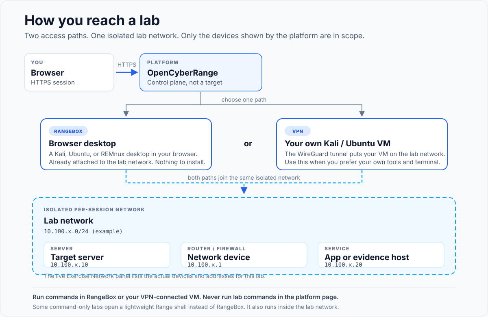
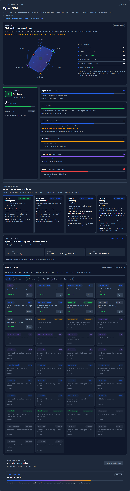
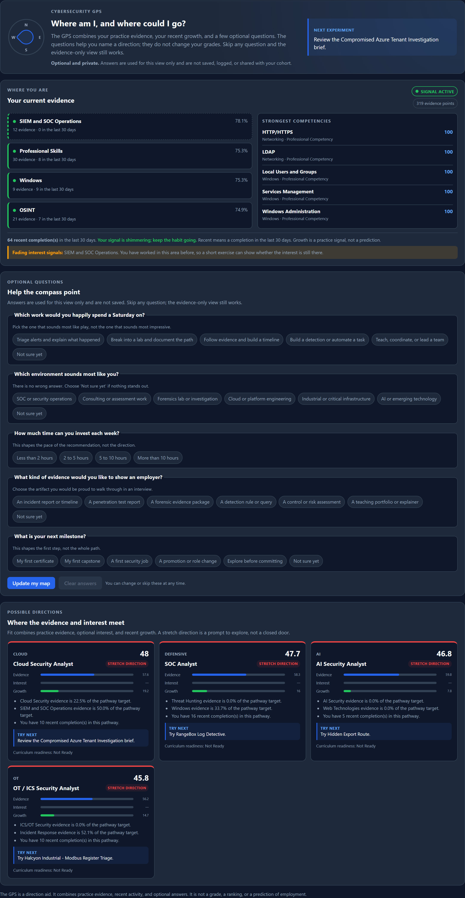

# SWOCTS Cyber Range Workbook

SWOCTS Cyber Range is powered by OpenCyberRange.

Welcome to the SWOCTS Cyber Range student workbook. Each exercise walkthrough guides you step by step, explains the underlying concepts, and prompts you to record and interpret your findings.

!!! note "AI-assisted content"
    Parts of this workbook were drafted with AI assistance and reviewed by a
    human maintainer. Verify every command, target, and flag against the running
    lab before relying on it. See `BUILD_NOTICE.md` in the repository root for
    attribution and the full AI-assistance disclosure.

!!! note "Example IP addresses"
    The walkthrough examples use `10.100.13.0/24`, the subnet in the reference
    setup. The platform assigns each student session its own `/24` and shows it
    in the **Active Lab View**. If your session uses a different subnet,
    substitute your address in every command. Workbook examples are static and
    may not reflect later changes to the address range.

## How you reach a lab

<figure markdown>

<figcaption>RangeBox and the VPN both join the same isolated lab network. The platform page is where you launch the exercise; it is not a target.</figcaption>
</figure>

There are three ways your commands can reach a lab:

| Path | What it is | Use it when |
|---|---|---|
| **RangeBox** | A browser desktop that is already attached to the lab network | You want to start immediately and do not need your own VM |
| **VPN** | Your own Kali or Ubuntu VM connected with WireGuard | You prefer your own tools, terminal, or notes |
| **Range shell** | A lightweight browser terminal inside the lab network | A command-only lab gives you a shell URL |

The **Exercise Network** panel in the platform lists the actual devices for the
running lab. A lab may contain a server, a workstation, a router, a firewall, a
database, or a sensor. Only the devices shown by the platform are in scope.

| Device in the lab | What it is | Do I run commands there? |
|---|---|---|
| Platform | The web application that launches and grades the lab | No. It is the control plane, not a target |
| RangeBox | Your browser workstation | Yes, from its terminal |
| VPN VM | Your own workstation on the lab network | Yes, from its terminal |
| Target server | The machine the exercise asks you to test | Only as the exercise directs |
| Router or firewall | A network device on the path | Only through the exercise's documented interface |

If you are ever unsure which machine you are on, run `hostname` and `ip addr`
(or `ipconfig` on Windows) in the terminal. The RangeBox and VPN VM have their
own addresses; the target is a different address shown in the panel.

## Your learning evidence

The workbook is the guided practice; the platform records what you did with it.
Your evidence is descriptive, not a grade:

- **Progress:** completed exercises, the next exercise, and course progress.
- **Cyber DNA:** six practice traits (Explorer, Builder, Tester, Defender,
  Investigator, Leader) and positive practice affinities. The Tester trait
  records authorised offensive practice in the isolated labs; it is not a
  licence to test real systems.
- **Knowledge checks:** optional benchmark practice with explanations and
  references. Never an exam or a gate.
- **Achievements:** badges for clean solves, persistence, and learning
  milestones.
- **Celebration Wall:** voluntary, anonymous appreciation from other signed-in
  users. It is not a leaderboard and does not affect any metric.
- **Privacy:** your profile and survey participation are controlled by you. See
  the student manual's privacy page.

<figure markdown>

<figcaption>Cyber DNA is the learner character sheet. Branches grow with strong practice, decay slowly when a branch goes quiet, and recover when you return.</figcaption>
</figure>

The **Cyber GPS** on the profile's Careers tab shows whether your practice
signal is active or fading and names domains you have worked in before as
fading interest signals. It is a prompt to revisit, not a ranking.

<figure markdown>

<figcaption>The Cyber GPS signal is based on completions in the last 30 days. A fading domain is a subject you have already invested in, not a failure.</figcaption>
</figure>

Use the workbook to build the habit; use the platform evidence to see the
practice accumulate.

## Available Tracks

<!-- BEGIN GENERATED WORKBOOK CURRICULUM -->
The workbook curriculum is generated from `curriculum-manifest.yaml`.
Every published chapter has a stable display ID, a physical directory, a
prerequisite chain, an exercise count, an estimated duration, and a
recommended next step.

Exercise counts are labs that expose a workbook page. The platform also
contains labs without a workbook page; see [Workbook coverage](COVERAGE.md).

See the [framework alignment](FRAMEWORKS.md) for the selective mapping.

| Track ID | Display name | Audience | Difficulty | Prerequisites | Exercises | Duration | Status |
|---|---|---|---|---|---:|---|---|
| `high-school` | Beginner Cybersecurity | Grades 9-12 learners with everyday computer experience and no assumed cybersecurity background. | beginner | None | 18 | 7h 00m | published |
| `netfor` | Network Security | Beginner-to-intermediate learners who need network foundations, log analysis, and packet evidence. | beginner | BEG04 | 22 | 19h 45m | published |
| `webpt` | Web Application Security | Intermediate learners who can use a terminal and understand HTTP basics. | intermediate | NET00, NET01 | 16 | 21h 35m | published |
| `software-security` | Software Security | Intermediate learners who can read code and understand web requests. | intermediate | WEB02 | 2 | 30m | published |
| `malware` | Malware Analysis | Intermediate learners with networking and forensic evidence experience. | intermediate | NET02, FOR01 | 10 | 7h 25m | published |
| `forensics` | Digital Forensics | Intermediate learners who want to investigate memory, disk, endpoint, email, browser, and network evidence. | intermediate | NET02 | 4 | 2h 35m | published |
| `osint` | OSINT | Adult learners who want public-source investigation skills; Grades 9-12 are not assigned the live extensions. | beginner | NET00 | 9 | 4h 50m | published |
| `identity` | Identity & Access | Intermediate learners interested in authentication, federation, and account lifecycle. | intermediate | NET00 | 39 | 75h 10m | published |
| `ot` | OT/ICS Security | Intermediate learners interested in industrial control systems and Modbus. | intermediate | NET00 | 4 | 3h 00m | published |
| `ai` | AI Hacking | Intermediate learners exploring prompt injection, policy bypass, and AI-assisted security. | intermediate | WEB02 | 5 | 4h 15m | published |
| `winpt` | Windows Penetration Testing | Intermediate learners who have completed the beginner pathway or have equivalent terminal and networking experience. | intermediate | BEG04, NET00 | 53 | 103h 15m | published |
| `linpt` | Linux Fundamentals | Intermediate learners building Linux enumeration, SSH access, privilege escalation, and detection skills. | intermediate | WIN09 | 30 | 38h 45m | published |
| `msfpt` | Metasploit Operations | Learners who have completed the beginner pathway or have equivalent Linux and network service experience. | intermediate | LIN01, NET00 | 8 | 13h 15m | published |
| `vm` | Vulnerability Management | Learners moving from exploitation into defensive exposure management, asset ownership, and remediation. | intermediate | BEG04, NET00 | 33 | 68h 00m | planned |
| `soc` | Security Operations | Learners who want hands-on detection, triage, hunting, and case management with open-source telemetry. | intermediate | NET02, FOR01 | 34 | 70h 00m | planned |
| `platform` | Platform Engineering | Learners who build and operate the delivery platform: containers, Kubernetes, CI/CD, infrastructure as code, and configuration management. | intermediate | LIN01, NET00 | 40 | 82h 00m | planned |
| `neteng` | Network Engineering and Infrastructure | Learners moving from packet-level analysis into network source of truth, monitoring, configuration control, segmentation, and network access control. | intermediate | NET00 | 35 | 72h 00m | planned |

**Total:** 362 exercises across 17 tracks and 93 chapters.

See the [full curriculum map](CURRICULUM.md) and the [cross-curriculum terminology](TERMINOLOGY.md).

Recommended pathway:

`BEG01` → `BEG02` → `BEG03` → `BEG04` → `NET00` → `NET01` → `NET01B` → `NET02` → `NET03` → `NET04` → `WEB01` → `WEB01B` → `WEB02` → `WEB02B` → `WEB03` → `SWSEC01` → `MAL01` → `MAL02` → `MAL03` → `FOR01` → `FOR02` → `FOR03` → `OSINT01` → `OSINT02` → `OSINT03` → `IAM01` → `IAM02` → `IAM03` → `IAM04` → `IAM05` → `IAM06` → `IAM07` → `IAM08` → `IAM09` → `OT01` → `OT02` → `AI01` → `AI02` → `WIN01` → `WIN02` → `WIN03` → `WIN04` → `WIN05` → `WIN06` → `WIN07` → `WIN08` → `WIN09` → `WIN10` → `LIN01` → `LIN01B` → `LIN02` → `LIN02B` → `LIN03` → `LIN03B` → `LIN04` → `LIN05` → `LIN09` → `MSF01` → `MSF02` → `VM01` → `VM02` → `VM03` → `VM04` → `VM05` → `VM06` → `VM07` → `VM08` → `SOC01` → `SOC02` → `SOC03` → `SOC04` → `SOC05` → `SOC06` → `SOC07` → `SOC08` → `PLAT01` → `PLAT02` → `PLAT03` → `PLAT04` → `PLAT05` → `PLAT06` → `PLAT07` → `PLAT08` → `PLAT09` → `NENG01` → `NENG02` → `NENG03` → `NENG04` → `NENG05` → `NENG06` → `NENG07` → `NENG08` → `NENG09`
<!-- END GENERATED WORKBOOK CURRICULUM -->

## How to Use This Workbook

See [Workbook coverage](COVERAGE.md) for the generated list of labs that expose
a workbook and the current count per track.

1. **Launch an exercise** in the SWOCTS Cyber Range platform
2. **Click the Workbook button** to open the walkthrough for that exercise
3. **Follow the steps** in the walkthrough while working in your terminal or the
   in-browser RangeBox desktop
4. **Record your findings** in the spaces provided
5. **Answer the analysis questions** to deepen your understanding

Each walkthrough includes background concepts, tool primers, guided steps, and analysis questions. The chapter reviews provide self-assessment quizzes and command cheat sheets.

### Reading the workbook in the RangeBox workspace

On a desktop, the exercise page keeps the RangeBox, the briefing, the flag
panel, and the workbook in one workspace. The workbook is the full-width pane
under the desktop. It hides the wiki header and sidebars, uses the full width for
the article, and scrolls on its own, so you can read a step and keep the desktop
open at the same time.

<figure markdown>

<figcaption>The workbook pane in the workspace. Use the pane's own scrollbar to move through the walkthrough while the RangeBox stays open.</figcaption>
</figure>

Use **Expand** to make the workbook pane taller. Use **Open in new tab** if you
prefer a separate reading tab. Use **Pop out** on the RangeBox to move the
desktop into its own window; the main tab then keeps the briefing, notes, and
workbook in view.

### Copying a flag from the desktop

When you find a flag inside the RangeBox, copy it as text. The in-window flag
field captures an `OCR{...}` value from the desktop clipboard automatically. If
the guest clipboard does not propagate, use **Paste** in the flag panel or press
Ctrl+V in the field. The field keeps only the flag value when you paste a whole
log line or shell prompt.

!!! warning "Text only"
    Files cannot leave or enter the RangeBox. The clipboard is text-only, and
    file drops and file pastes are rejected. Record your evidence as text and
    screenshots outside the desktop, or use the workbook's recording prompts.
