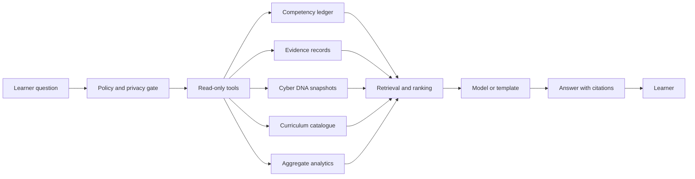

# AI Mentor

Status: **Release 6.4, planning.** The mentor is gated on the competency model,
the Evidence Engine, and instructor analytics. Without those, it is a chatbot.

The mentor answers four questions:

```text
What should I study next?
Why did my competency change?
What career path fits my strengths?
Which labs should I take?
```

Every answer is grounded in the learner's own evidence, cites the record it used,
and separates a deterministic fact from a recommendation. It does not grade, does
not make a high-impact decision, and does not see raw artifacts unless the learner
explicitly shares one.

## What it is not

- Not a general-purpose chatbot with a security prompt.
- Not an automated grader or a final-grade authority.
- Not a cross-institution model trained on learner data.
- Not a source of truth. The competency ledger and the evidence record are.
- Not a replacement for an instructor, advisor, or accessibility accommodation.

## Grounding



The retrieval layer uses local curriculum content and the learner's own evidence
summary. It does not retrieve another learner's record, another tenant's data, or
a public web page as evidence.

## Capabilities

| Question | Inputs | Output | Citation |
|---|---|---|---|
| What should I study next? | Competency gaps, prerequisites, completed labs, interests | A ranked practice set with time estimates | Competency IDs, missing dimensions, lab contracts |
| Why did my competency change? | Snapshot diff, new evidence, rubric reviews, formula version | A plain-language explanation of what moved and why | Evidence IDs, review decisions, formula version |
| What career path fits my strengths? | Cyber DNA affinity, role readiness, evidence bands, interests | Two or three paths with evidence bands and gaps | Role profile, competency evidence, confidence gate |
| Which labs should I take? | Prerequisites, availability, difficulty, learning goal | A short sequence with a reason for each lab | Lab contracts, prerequisites, availability |

## Explanation rules

- Every factual claim cites a record: a competency ID, an evidence ID, a snapshot,
  or a lab slug.
- A recommendation states why it is recommended, what it assumes, and what it
  does not know.
- A low-confidence answer says so and offers a deterministic view instead.
- A competency change is never attributed to a model. It is attributed to
  evidence, a rubric decision, or a formula version.
- The mentor never claims a learner is "job ready". It reports curriculum
  readiness and the evidence behind it.
- The mentor never compares the learner with another named learner.

## Deterministic fallback

If the model is unavailable, over budget, or fails a policy check, the mentor
falls back to templates over the same data:

- Next-step list from the competency gap and prerequisite graph.
- Snapshot diff table.
- Role-readiness bands and gaps.
- Lab sequence from the current pathway.

The fallback is a supported mode, not an error page. It is also the reference
answer used to evaluate the model's groundedness.

## Architecture

| Layer | Responsibility |
|---|---|
| Policy gate | PII redaction, tenant check, consent, under-18 rules, prompt-injection defence |
| Tool layer | Read-only functions for competencies, evidence, snapshots, catalogue, aggregate analytics |
| Retrieval | Local curriculum chunks, rubric descriptors, and structured records |
| Model gateway | Self-hosted model or an approved provider; no training on learner data |
| Output filter | Citation check, PII check, unsafe-content check, confidence check |
| Audit | Question, tools called, records cited, model version, latency, outcome |
| Evaluation | Groundedness, citation accuracy, helpfulness, bias, privacy, latency |

The tool layer is the only path to data. The model cannot query the database,
the filesystem, Docker, or another tenant directly.

## Privacy and safety

- **No PII in prompts or logs.** Names, emails, student IDs, IP addresses, and
  free-text narratives are removed before a model call.
- **No raw artifacts.** Reports, screenshots, and scan output are summarized by a
  deterministic extractor before use.
- **No cross-tenant retrieval.** Every tool call is scoped to the learner and
  tenant.
- **No training on learner data.** A provider contract must prohibit training and
  retention.
- **Self-hosted option.** An institution can run a local model and keep every
  token inside its boundary.
- **Prompt-injection defence.** Curriculum and evidence text is untrusted input;
  tool calls are allow-listed and arguments validated.
- **Human oversight.** The mentor recommends; the learner and instructor decide.
  A high-impact academic decision is never delegated to it.
- **Consent and deletion.** A learner can disable the mentor, and erasure removes
  its conversation history.

## Evaluation

Before release, and after any model change:

| Test | Measure | Gate |
|---|---|---|
| Groundedness | Share of claims with a valid citation | 100% for factual claims |
| Citation accuracy | Cited record actually supports the claim | At least 98% on a sampled set |
| Hallucination | Invented competency, lab, or evidence | Zero tolerated |
| Helpfulness | Learner-rated usefulness and next-step clarity | Pilot target set with students |
| Bias | Recommendation parity across synthetic learner profiles | No unexplained disparity |
| Privacy | PII leakage in prompts, logs, and outputs | Zero |
| Prompt injection | Attempts to escape the tool policy | Zero successful escapes |
| Latency | p95 response time | Under 10 seconds for a grounded answer |
| Cost | Tokens per answer and per active learner | Within the institution's budget |

The evaluation harness uses synthetic learners and a red-team corpus. Results are
published with the release.

## Academic value

- **Scalable, explainable advising.** Learners get a next step and the evidence
  behind it, without waiting for an office hour.
- **Transparent competency change.** A score is explained by evidence and a
  rubric, not a black box.
- **Privacy-preserving personalization.** The institution keeps the data and can
  run the model locally.
- **AI literacy by example.** The mentor shows its sources, uncertainty, and
  limits, which is the behaviour we want learners to copy.
- **Research surface.** With consent and ethics approval, the evaluation can
  study advising quality and equity without exposing learner records.

## Acceptance criteria

- Every factual claim cites a record that exists and supports the claim.
- The deterministic fallback answers all four questions without a model.
- No PII or raw artifact reaches a model or a log.
- A tenant-boundary test cannot retrieve another tenant's evidence.
- A learner can disable the mentor and erase its history.
- The evaluation report is published with the release.
- An instructor can see that the mentor is advisory and cannot change a grade.
