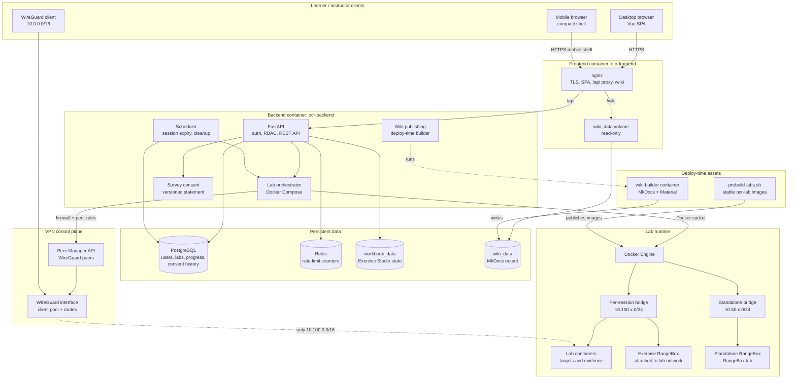

# SWOCTS Cyber Range: system architecture

SWOCTS Cyber Range is powered by OpenCyberRange. The runtime components and trust boundaries below describe that deployment.

This is the runtime architecture of a production OpenCyberRange deployment. It
shows the request path, the data stores, the lab runtime, the VPN boundary, and
the deploy-time asset builders.

## Request and data flow

1. A learner signs in through nginx. The SPA calls `/api`, which nginx proxies
   to the FastAPI backend over the private Compose network. At phone widths the
   same SPA switches to the mobile shell with an off-canvas drawer and a student
   bottom tab bar.
2. The backend authenticates the JWT, checks the role, and reads or writes
   PostgreSQL. Redis holds shared rate-limit counters so every worker enforces
   the same limit.
3. Starting a lab creates a per-session Docker network and a Compose project.
   The backend uses the Docker socket to start the lab from a prebuilt
   `ocr-lab/<slug>-<service>:latest` image. Session networks are isolated from
   each other and from the management LAN.
4. If the learner chooses RangeBox, the backend also creates a desktop
   container. An exercise-attached RangeBox joins the session network at
   `10.100.x`; a standalone RangeBox from the RangeBox tab runs on its own
   `10.50.x` bridge. The backend waits for VNC port `6080` before reporting the
   desktop ready, and the deployed count includes containers from creation.
5. WireGuard clients reach only the lab networks under `10.100.0.0/16`. The
   Peer Manager applies and persists the firewall rules.
6. The frontend serves the SPA and the prebuilt workbook wiki. The wiki is a
   build artifact in the `wiki_data` volume, not part of the frontend image.
7. The `wiki-builder` container runs MkDocs with a pinned toolchain and
   publishes tracks, the reference manual, and any course wikis into
   `wiki_data`. The frontend mounts that volume read-only.
8. Lab images are built ahead of time and tagged with stable names. The spawn
   path never builds an image in production; a missing image fails with a clear
   prebuild instruction.

## Trust boundaries

| Boundary | Control |
|---|---|
| Internet → frontend | TLS, nginx, API rate limits, CSP/security headers |
| Frontend → backend | Private Compose network; backend bound to localhost on the host |
| Backend → Docker | Docker socket; treat the backend host and `docker` group as privileged |
| Learner → labs | WireGuard peer; firewall allows only `10.100.0.0/16`; one `/24` per session |
| Learner → RangeBox | HTTPS browser desktop through the backend WebSocket proxy; standalone boxes use an isolated `10.50.x` bridge |
| RangeBox → lab | Exercise-box only; attached to that session's bridge and removed on teardown |
| Lab → lab | Separate per-session bridge networks; no cross-session routing |
| Lab → management LAN | Firewall drops lab and RangeBox subnets from external interfaces |
| Wiki build → runtime | Builder writes to a volume; frontend mounts it read-only |
| Survey consent | Explicit opt-in, versioned statement, append-only consent history |

## Volumes and state

| Volume | Data | Backup |
|---|---|---|
| `opencyberrange_postgres_data` | All platform rows, including consent history | PostgreSQL dump |
| `opencyberrange_workbook_data` | Exercise Studio builder state and erasure ledger | Copy with the database backup |
| `opencyberrange_wiki_data` | Generated wiki HTML for tracks, manual, and courses | Rebuild from source; not user data |

## Related documents

- [Learning framework](LEARNING-FRAMEWORK.md)
- [NICE mapping matrix](NICE-MAPPING.md)
- [Survey privacy and consent](SURVEY-PRIVACY.md)
- [Privacy, erasure, and backups](PRIVACY-AND-DATA-DELETION.md)
- [Deployment manual](../Manual-Lite/00_Server_Deployment/08_Docker_Deploy_Manual.md)
