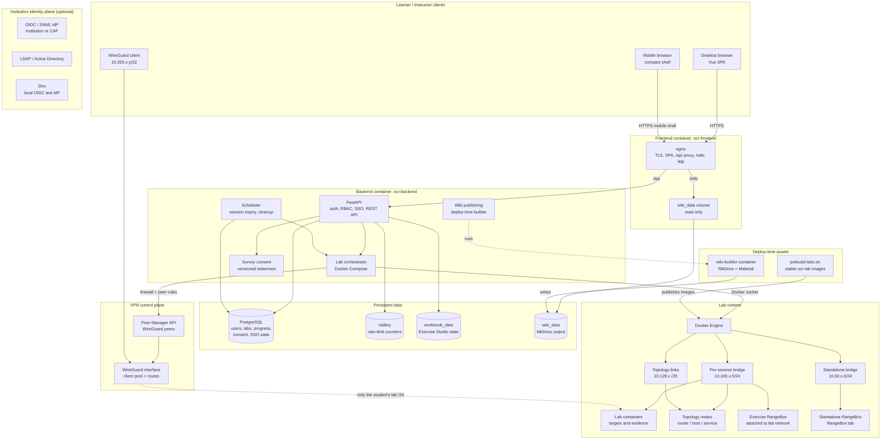

# SWOCTS Cyber Range: system architecture

SWOCTS Cyber Range is powered by OpenCyberRange. The runtime components and trust boundaries below describe that deployment.

This is the runtime architecture of a production OpenCyberRange deployment. It
shows the request path, the data stores, the lab runtime, the VPN boundary, and
the deploy-time asset builders.

## Request and data flow

1. A learner signs in through nginx. The SPA calls `/api`, which nginx proxies
   to the FastAPI backend over the private Compose network. At phone widths the
   same SPA switches to the mobile shell with an off-canvas drawer and a student
   bottom tab bar.
2. The backend authenticates the JWT, checks the role, and reads or writes
   PostgreSQL. Redis holds shared rate-limit counters so every worker enforces
   the same limit.
3. Starting a lab creates a per-session Docker network and a Compose project.
   The backend uses the Docker socket to start the lab from a prebuilt
   `ocr-lab/<slug>-<service>:latest` image. Session networks are isolated from
   each other and from the management LAN.
4. If the learner chooses RangeBox, the backend also creates a desktop
   container. An exercise-attached RangeBox joins the session network at
   `10.100.x`; a standalone RangeBox from the RangeBox tab runs on its own
   `10.50.x` bridge. The backend waits for VNC port `6080` before reporting the
   desktop ready, and the deployed count includes containers from creation.
5. WireGuard clients use a `/32` address in the `10.255.x.y` range and route
   only their own stable lab `/24` (allocated from `10.100.0.0/16`). The client
   no longer claims a `/16` or routes the whole `10.100-10.255` space, which
   avoids overlapping common home networks. The Peer Manager applies and
   persists the firewall rules.
6. The frontend serves the SPA and the prebuilt workbook wiki. The wiki is a
   build artifact in the `wiki_data` volume, not part of the frontend image.
7. The `wiki-builder` container runs MkDocs with a pinned toolchain and
   publishes tracks, the reference manual, and any course wikis into
   `wiki_data`. The frontend mounts that volume read-only.
8. Lab images are built ahead of time and tagged with stable names. The spawn
   path never builds an image in production; a missing image fails with a clear
   prebuild instruction.

## Trust boundaries

| Boundary | Control |
|---|---|
| Internet → frontend | TLS, nginx, API rate limits, CSP/security headers; `/docs`, `/redoc`, and `/openapi.json` return 404 at nginx |
| Frontend → backend | Private Compose network; backend bound to localhost on the host |
| Backend → Docker | Docker socket; treat the backend host and `docker` group as privileged |
| Application → database | Parameterized ORM/SQL, least-privilege app role, backup and restore checks, append-only change ledger, signed table checksums; manual SQL is recorded as unattributed |
| Learner → labs | WireGuard peer with a `/32` client address; the client routes only its own `/24`; firewall allows only `10.100.0.0/16` |
| Learner → RangeBox | HTTPS browser desktop through the backend WebSocket proxy; standalone boxes use an isolated `10.50.x` bridge |
| RangeBox → lab | Exercise-box only; attached to that session's bridge and removed on teardown |
| Lab → lab | Separate per-session bridge networks; no cross-session routing |
| Lab → management LAN | Firewall drops lab and RangeBox subnets from external interfaces |
| Topology node → lab | Extra `/29` links inside the protected `10.128.0.0/9` range; no host network, bind mounts, or Docker socket; only `NET_ADMIN`/`NET_RAW` |
| Wiki build → runtime | Builder writes to a volume; frontend mounts it read-only |
| Survey consent | Explicit opt-in, versioned statement, append-only consent history |

## Threat assessment (STRIDE/DREAD)

The trust boundaries above are assessed with **STRIDE** to enumerate credible
threats and **DREAD** to prioritise them. This is a design-review aid, not a
penetration-test result or a certification. Scores are qualitative and are
re-scored when a boundary, control, or deployment shape changes.

### Scope and assumptions

- The assessment covers the supported single-host **Community / Academic** and
  **Professional** profiles. The Enterprise HA preview is assessed separately in
  [`V3-HA-LAB-POOL.md`](V3-HA-LAB-POOL.md).
- Attacker capabilities considered: unauthenticated internet access, an
  authenticated learner, an authenticated instructor, and code running inside a
  lab container.
- Host root, Docker daemon access, and physical access are **out of scope** for
  scoring because they already imply full compromise. They remain operational
  risks and are called out below where relevant.
- Lab containers are intentionally vulnerable and may be hostile. The host and
  management network are the assets that must survive a compromised lab.
- DREAD is a prioritisation heuristic. It does not replace CVSS, a threat-model
  review, or an external penetration test.

### Scoring

**STRIDE:** Spoofing, Tampering, Repudiation, Information disclosure, Denial of
service, Elevation of privilege.

**DREAD:** Damage, Reproducibility, Exploitability, Affected users,
Discoverability. Each factor is scored **1–5**; the score is their mean.

| Band | Score | Action |
|---|---|---|
| Critical | 4.5–5.0 | Block release; fix or formally accept with an owner and expiry |
| High | 3.5–4.4 | Fix in the release or record a time-boxed exception |
| Medium | 2.5–3.4 | Track, test, and mitigate where practical |
| Low | 1.0–2.4 | Accept and review at the next release |

### Threat register

| ID | Boundary | STRIDE | Threat | DREAD (D/R/E/A/Di) | Rating | Remediation and residual risk |
|---|---|---|---|---|---|---|
| T01 | Internet → frontend | Spoofing | A stolen JWT is replayed as a learner or instructor | 3/3/2/3/2 = 2.6 | Medium | Signed JWT with a 24-hour default expiry, revocation, login lockout, rate limits, MFA for privileged accounts, and CSP to reduce token theft. Residual: a stolen token is usable until expiry or revocation; there is no device binding. Planned: HttpOnly session cookie and CSRF protection (see `SECURITY-REVIEW-2026-11.md`). |
| T02 | Internet → frontend | Tampering | A client changes a user, course, lab, attempt, or certificate identifier to act on another object | 4/4/2/4/3 = 3.4 | Medium | Server-side RBAC and ownership checks on every object; identifiers are resolved server-side; Pydantic request schemas; cross-user tests. Residual: a missed route is a defect, so authorization coverage is reviewed per change. |
| T03 | Internet → frontend | Repudiation | A learner or instructor denies submitting feedback, exporting data, or changing a grade | 2/3/2/2/3 = 2.4 | Low | Activity and audit events record actor, action, target, and time; exports record a reason; consent history is append-only; timestamps are UTC. Residual: retention depends on the operator's backup and log policy. |
| T04 | Internet → frontend | Information disclosure | An IDOR or over-broad analytics query exposes another learner's data | 4/3/2/4/3 = 3.2 | Medium | Enrollment and instructor-ownership scoping before aggregation; aggregate-only course metrics; public certificate verification returns minimal fields; `Cache-Control: no-store` on sensitive exports; anonymous comments. Residual: small cohorts can still be inferable, so sample sizes are shown and minimum-sample labels are used. |
| T05 | Internet → frontend | Denial of service | Login, lab spawn, export, or quiz traffic exhausts workers, Docker, or disk | 3/4/2/4/3 = 3.2 | Medium | Shared Redis rate limits per route, per-user quotas, RangeBox CPU/disk gates, scheduler expiry and cleanup, health checks, and restart policies. Residual: an authenticated user can still consume their quota; host capacity is the final limit. |
| T06 | Internet → frontend | Elevation of privilege | A student reaches an instructor or administrator endpoint | 5/3/2/4/2 = 3.2 | Medium | Separate role dependencies; admin routes require the admin role; MFA and re-authentication for sensitive admin actions; negative authorization tests. Residual: role misconfiguration remains an operational risk. |
| T07 | Frontend → backend | Spoofing | Another host process impersonates nginx or calls the API directly | 4/2/2/4/2 = 2.8 | Medium | The backend publishes only on `127.0.0.1`, runs on a private Compose network, and uses a CORS allowlist. Residual: any local host process can reach `127.0.0.1:8000`; host hardening and least-privilege accounts apply. |
| T08 | Frontend → backend | Tampering | Forged forwarding headers or Origin bypass the intended client path | 3/3/2/3/2 = 2.6 | Medium | nginx sets the proxy headers; CORS is allowlisted; the application never trusts a client-supplied identity; rate limits key on the trusted peer. Residual: proxy trust is deployment-specific and must be reviewed when the edge changes. |
| T09 | Backend → Docker | Elevation of privilege | A malicious or compromised lab image, or an orchestrator bug, escapes to the host | 5/2/3/5/3 = 3.6 | High | Images are prebuilt from reviewed lab sources and are never user-supplied; labs run without privileged mode, host networking, or the Docker socket; each session gets its own bridge; teardown removes the project. The Docker socket is mounted only in the backend. Residual: a kernel or Docker escape remains a host-level risk; patch the host and Docker promptly. |
| T10 | Backend → Docker | Tampering | One session's lab attacks another session or the management network | 4/2/2/4/2 = 2.8 | Medium | One bridge and one `/24` per session; no cross-session routing; firewall rules drop lab and RangeBox subnets from external interfaces. Residual: a host-level network misconfiguration could bridge sessions, so firewall state is part of the release check. |
| T11 | Backend → Docker | Denial of service | A lab or RangeBox consumes all CPU, memory, or disk | 3/4/2/4/3 = 3.2 | Medium | RangeBox capacity gates, container limits where set, scheduler expiry and cleanup, and a prebuild disk guard. Residual: not every lab has a hard CPU quota; host monitoring and capacity planning are required. |
| T12 | Learner → labs (VPN) | Spoofing | A stolen WireGuard key joins the lab network | 4/3/3/3/2 = 3.0 | Medium | Per-user peer keys, Peer Manager provisioning and revocation, firewall access limited to `10.100.0.0/16`, and peer removal on teardown. Residual: key material on a compromised client; offline revocation is not instantaneous. |
| T13 | Learner → labs (VPN) | Information disclosure | A learner sniffs another learner's lab traffic or reaches the management LAN | 4/2/3/4/2 = 3.0 | Medium | Per-session `/24`, a `/32` client address, client-side routing limited to the learner's own `/24`, the WireGuard firewall, the `DOCKER-USER` accepts, the UFW bridge rule, and external-interface drops. Residual: a host kernel or firewall misconfiguration can break isolation. |
| T14 | Learner → RangeBox | Elevation of privilege | The browser desktop escapes its container or reaches the lab or host | 4/2/3/3/3 = 3.0 | Medium | VNC is never exposed directly; it is proxied behind authentication. Standalone boxes use an isolated `10.50.x` bridge, exercise boxes attach only to their session, and teardown removes both. Residual: the desktop attack surface and the learner's browser remain exposure points. |
| T15 | Lab → management LAN | Tampering | A lab container changes host firewall or routing state | 4/2/2/4/2 = 2.8 | Medium | No privileged mode and no host networking; `NET_ADMIN` is scoped to the lab namespace; host firewall state is applied by the Peer Manager and installer. Residual: kernel networking vulnerabilities and operator firewall drift. |
| T16 | Wiki build → runtime | Tampering | Compromised or careless wiki content injects script into the learner origin | 3/2/3/4/3 = 3.0 | Medium | Pinned MkDocs toolchain, build-time only, output mounted read-only, course-wiki authoring restricted to instructors, and CSP on the served document. Residual: MkDocs does not sanitise every author-supplied HTML fragment; instructor content is trusted. |
| T17 | Survey consent | Information disclosure / Repudiation | Feedback is linked to a learner or collected without consent | 4/2/3/4/2 = 3.0 | Medium | Explicit opt-in, a versioned statement, append-only consent history, anonymous aggregation, erasure support, and no public scoreboard. Residual: free-text comments can self-identify, and small samples can still reveal a cohort. |
| T18 | Supply chain | Tampering | A dependency or base image introduces a vulnerability or backdoor | 4/3/2/5/3 = 3.4 | Medium | Pinned versions, `pip-audit`, `npm audit`, CodeQL, Dependabot, prebuilt reviewed images, a committed SHA-256 supply-chain lock, and release evidence. Residual: a zero-day or a compromised upstream remains possible. |
| T19 | Application → database | Tampering | Manual SQL or an uninstrumented path changes critical data without a record | 4/3/2/4/2 = 3.0 | Medium | Append-only change ledger with actor attribution, row and chain hashes, an immutable ledger trigger, signed table checksums, and a quality audit. Manual writes are reported as `unattributed`. Residual: a database superuser can disable triggers; the ledger is tamper-evident, not tamper-proof. |
| T20 | Deleted user lifecycle | Integrity / Availability | A deleted account leaves null references that break a dashboard or inflate a metric | 3/2/2/3/2 = 2.4 | Low | Cascade and `SET NULL` rules, course-transfer block, null-safe UI labels, orphaned-coaching exclusion, and database quality checks. Residual: an uninstrumented table can still need a null fallback. |

### Highest residual risks

1. **Host and Docker compromise (T09).** Treat the backend host and the `docker`
   group as privileged. Do not co-locate untrusted workloads, keep the host and
   Docker patched, and restrict socket access to the backend.
2. **Firewall-dependent isolation (T10, T13, T15).** Session isolation is only as
   strong as the host firewall. Re-verify it after every VPN, Docker, or UFW
   change and include it in the release check.
3. **Trusted instructor content (T16).** Course-wiki authors can add HTML.
   Restrict authoring, keep CSP enabled, and review course wikis before
   publishing.
4. **Client-side secrets (T01, T12).** JWT and WireGuard keys live on learner
   devices. Use short expiry, revocation, and device security guidance.
5. **Supply chain (T18).** Keep the dependency and image inventory pinned, run
   the audits on every release, and record the evidence.
6. **Small-cohort inference (T04, T17).** Aggregate reporting is not anonymity
   for a cohort of one. Show sample sizes and suppress or label small groups.

### Change-review checklist

When a change adds or moves a boundary, or adds a new data flow:

1. Name the boundary and the asset on each side.
2. List the applicable STRIDE categories and the credible threat.
3. Re-score DREAD, or record why the score is unchanged.
4. Link the control and the evidence, and record any accepted residual risk with
   an owner and expiry.

The current control evidence is recorded in
[`V2-SECURITY-EVIDENCE.md`](V2-SECURITY-EVIDENCE.md) against the
[`OWASP Top 10 baseline`](V2-SECURITY-OWASP-TOP-10.md).

## Database integrity and change attribution

The database is a trust boundary, not just a store. The platform adds three
controls:

1. **One-way passwords.** New and changed passwords use Argon2id; legacy bcrypt
   verifies and upgrades on a successful sign-in. The database stores a one-way
   hash only; there is no plaintext or reversible password storage.
2. **Signed table checksums.** `scripts/database_integrity.py` computes SHA-256
   checksums for critical tables and a database fingerprint. A signed manifest
   is the release evidence for a point-in-time snapshot.
3. **Append-only change ledger.** A PostgreSQL trigger records every
   `INSERT`, `UPDATE`, and `DELETE` on a critical table with a row hash, actor
   type, actor id, request id, previous hash, and entry hash. Application writes
   are `user` or `system`; direct SQL writes are `unattributed` and are reported.
   The ledger has an immutable trigger and rejects `UPDATE`/`DELETE`.

The quality audit covers foreign-key orphans, duplicate keys, invalid enums,
null critical fields, invalid JSON, bad quiz and feedback ranges, missing
settings, and password hash format. Deleted users cascade or null their optional
references; courses block erasure until ownership is transferred; dashboards
render explicit “Deleted user / learner / participant” labels.

Full design, commands, evidence, and residual limits:
[Database integrity and change attribution](DATABASE-INTEGRITY.md).

## Volumes and state

| Volume | Data | Backup |
|---|---|---|
| `opencyberrange_postgres_data` | All platform rows, including consent history | PostgreSQL dump |
| `opencyberrange_workbook_data` | Exercise Studio builder state and erasure ledger | Copy with the database backup |
| `opencyberrange_wiki_data` | Generated wiki HTML for tracks, manual, and courses | Rebuild from source; not user data |

## Related documents

- [Learning framework](LEARNING-FRAMEWORK.md)
- [NICE mapping matrix](NICE-MAPPING.md)
- [Cyber DNA](SKILL-DNA.md)
- [Celebration Wall](CELEBRATION-WALL.md)
- [Supply-chain verification](SUPPLY-CHAIN.md)
- [Database integrity](DATABASE-INTEGRITY.md)
- [Survey privacy and consent](SURVEY-PRIVACY.md)
- [Privacy, erasure, and backups](PRIVACY-AND-DATA-DELETION.md)
- [Deployment manual](../Manual-Lite/00_Server_Deployment/08_Docker_Deploy_Manual.md)
