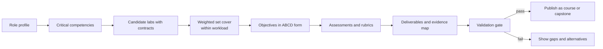

# Capstone Builder

Status: **Release 6.1, backend planner and saved plans implemented.** The
deterministic planner, validation gate, saved-plan API, versioning, and approval
exist. The editor UI, publication to a course, and exports are not implemented
yet.

The Capstone Builder turns a role profile into a teachable, assessable capstone.
An instructor selects a profile such as **Blue Team Analyst** (the existing
`soc-analyst` pathway), and the platform assembles objectives, labs, assessments,
and deliverables from the competency model. The instructor edits and approves the
plan; the platform never publishes a capstone without that review.

It is not an essay generator and it does not grade. It is a constrained planner
over the competency contracts, the lab catalogue, the evidence model, and the
institution's assessment policy.

## Implemented slice

`GET /api/capstones/profiles` lists the 13 role profiles. `POST
/api/capstones/plan` returns a proposal with objectives, a lab sequence,
assessments, deliverables, an evidence map, and a validation gate.

The planner is deterministic:

- candidate labs come from the reviewed contracts in the profile's tracks;
- a greedy weighted set cover selects labs within `max_labs` and the workload
  budget;
- reviewed contracts and higher reliability score first;
- prerequisites are ordered when selected; a missing prerequisite is listed and
  can be treated as an assumed entry level;
- an instructor can waive a critical competency only with a written reason;
- the gate checks coverage, workload tolerance, assessment weights, objective
  evidence, prerequisites, and waiver validity.

The current bank exposes a real curriculum gap: the `soc-analyst` profile has 29
critical competencies, but the matching contracts cover about half of them. A
waived, 12-hour plan with 9 labs and an assumed entry level passes the gate; an
unwaived 40-hour plan does not. That is the planner doing its job, not a bug.

## API

| Method | Path | Purpose |
|---|---|---|
| GET | `/api/capstones/profiles` | Role profiles, critical competency counts, tracks, capstone brief |
| POST | `/api/capstones/plan` | Generate a proposal and validation report |
| POST | `/api/capstones/plans` | Save a draft plan with a version |
| GET | `/api/capstones/plans` | List the caller's plans |
| GET | `/api/capstones/plans/{id}` | Read a saved plan and its request |
| PUT | `/api/capstones/plans/{id}` | Regenerate a draft, increment the version, clear approval |
| POST | `/api/capstones/plans/{id}/approve` | Approve only when the validation gate passes |
| POST | `/api/capstones/plans/{id}/archive` | Archive a plan without deleting it |
| GET | `/api/capstones/plans/{id}/export.md` | Markdown learner brief and instructor guide |
| GET | `/api/capstones/plans/{id}/export.pdf` | PDF learner brief and instructor guide |

The endpoints require an instructor, administrator, mentor, or teaching
assistant. A learner receives `403 capstone_forbidden`.

## Exports

`GET /api/capstones/plans/{id}/export.md` and `.pdf` render a saved plan as a
document for the instructor or the programme file:

- validation gate and waivers;
- objectives and competencies;
- lab sequence with hours and contract state;
- assessments, weights, and rubrics;
- deliverables and the evidence map;
- instructor notes.

The export contains no learner records, prompts, or model output. PDF output
uses the shared report metadata and accessibility helpers. A Common Cartridge or
LMS package is still not implemented.

## What is not implemented

- A visual editor.
- Publishing to a course, event, or standalone capstone.
- Generating the learner brief and instructor guide as documents.
- Exporting a Common Cartridge or PDF package.

Those are the next 6.1 slices. A saved plan can be approved, but approval does
not publish anything today.

## Saved-plan rules

- A saved plan belongs to the instructor who created it.
- An administrator or institution administrator can see plans in their tenant.
- Another instructor receives `404 capstone_not_found`.
- Editing rebuilds the plan, increments the version, returns the status to
  `draft`, and clears the approval.
- Approval refuses a plan whose validation gate has not passed.
- An archived plan cannot be edited or approved.

## Example

```text
Instructor selects: Blue Team Analyst
OpenCyberRange builds:
  Objectives     6, each mapped to critical competencies
  Labs           8, sequenced with prerequisites and workload
  Assessments    3, formative and summative, rubric-scored
  Deliverables   4, authentic artefacts an employer would recognise
  Validation     coverage, prerequisites, workload, evidence, weights
```

The result is a 40-hour capstone that can become a course module, an event, or a
final assessment.

## Inputs

```yaml
profile: soc-analyst            # aliases include "Blue Team Analyst"
level: advanced
duration_hours: 40
delivery: hybrid                # in-person, online, or hybrid
constraints:
  max_labs: 10
  available_tracks: [forensics, network, winpt, linpt, identity]
  required_deliverables: [timeline, finding, remediation, executive_brief]
  assessment_weights:
    formative: 0.30
    summative: 0.50
    capstone_defence: 0.20
accreditation:
  - nice
  - cs2023
  - cae-cd
```

The profile is resolved from `app/data/curriculum-roles.yaml`. The critical
competency list, level requirements, existing capstone brief, and evidence
expectations are already defined there.

## Outputs

| Output | Contents |
|---|---|
| Capstone plan | Objectives, sequence, schedule, prerequisites |
| Lab set | Selected labs with coverage and workload |
| Assessments | Formative and summative tasks with rubrics |
| Deliverables | Artefacts, templates, and submission rules |
| Evidence map | Which evidence each objective requires |
| Validation report | Coverage, gaps, workload, weight totals, warnings |
| Instructor guide | Facilitation notes, timing, common failure modes |
| Learner brief | Scenario, tasks, deliverables, rubric, deadline |
| Export package | YAML/JSON, workbook chapter, LMS Common Cartridge, PDF |

## Generation pipeline

The pipeline is deterministic and explainable. An LLM may draft prose after the
plan is fixed; it does not choose the competencies or the evidence.



1. **Resolve the profile.** Load critical competencies, level targets, capstone
   brief, and evidence expectations.
2. **Score candidate labs.** For each lab, use the reviewed competency contract:
   competency weights, difficulty, duration, prerequisites, reliability, and
   availability.
3. **Select the lab set.** Solve a weighted set-cover problem with a duration
   budget. Prefer reviewed contracts, clean harness results, and coverage of
   critical competencies. Ties are broken by prerequisite order and lower
   duration.
4. **Write objectives.** Use the ABCD form (audience, behaviour, condition,
   degree) with observable verbs from the competency definition.
5. **Design assessments.** Map each objective to a formative or summative task
   and a rubric criterion. Ensure every competency has at least one evidence
   path.
6. **Define deliverables.** Start from the role's capstone deliverables; add
   the artefacts the evidence model can collect.
7. **Build the evidence map.** Objective -> competency -> evidence type ->
   reviewer.
8. **Validate.** Run the gate below. A failed gate returns specific gaps and
   alternative labs, not a generic error.
9. **Render and publish.** Produce the instructor guide, learner brief, and
   export package; publish as a course, event, or standalone capstone.

## Worked example: Blue Team Analyst

Profile: `soc-analyst` (Blue Team Analyst). Duration: 40 hours. Level: advanced.

### Objectives

| # | Objective | Competencies |
|---|---|---|
| 1 | Given a Windows host image, reconstruct a process and persistence timeline | FOR-005, FOR-007, IR-003 |
| 2 | Given network and host evidence, identify the entry vector and explain the confidence | NET-031, NET-033, IR-002 |
| 3 | Correlate identity, endpoint, and network events into one attack path | SIEM-002, SIEM-004, SOC-001 |
| 4 | Write detection logic for the observed behaviour and test it against benign data | SIEM-006, SOC-002 |
| 5 | Recommend containment, eradication, and recovery with explicit trade-offs | IR-004, IR-005, IR-006 |
| 6 | Brief a non-specialist executive and defend the findings under review | PROF-001, PROF-009, PROF-010 |

### Lab set

| Order | Lab | Purpose | Hours |
|---:|---|---|---:|
| 1 | `forensics-1-1-windows-memory-volatility` | Memory triage and process evidence | 4 |
| 2 | `forensics-3-1-live-linux-memory` | Second-host evidence and acquisition discipline | 4 |
| 3 | `linux-1-1-ssh-service-detection` | Service discovery and baseline reasoning | 3 |
| 4 | `windows-11-1-ad-domain-enumeration` | Identity enumeration and directory evidence | 4 |
| 5 | `windows-11-4-acl-dacl-abuse` | Privilege path and persistence reasoning | 5 |
| 6 | `network-12-6-appliance-segment` | Segment evidence and control boundaries | 4 |
| 7 | `forensics-2-1-voip-call-reconstruction` | Cross-media reconstruction | 4 |
| 8 | `forensics-2-3-topology-forensics-independent` | Independent investigation | 6 |

Total lab time: 34 hours. The remaining 6 hours are assessment, defence, and
remediation planning.

### Assessments

| # | Type | Task | Weight | Rubric |
|---|---|---|---:|---|
| 1 | Formative | Evidence table for labs 1-4 with source, time, hash, and relevance | 15% | Evidence and provenance |
| 2 | Formative | Detection rule plus benign and malicious test results | 15% | Detection quality and false-positive analysis |
| 3 | Summative | Ransomware investigation package: timeline, entry vector, movement map, remediation, executive brief | 50% | Integrated investigation |
| 4 | Defence | 10-minute briefing plus 5-minute questions | 20% | Communication and defensibility |

Weights total 100%. A learner must pass the summative and the defence
independently; a strong report cannot compensate for an indefensible briefing.

### Deliverables

| Deliverable | Evidence type | Reviewer |
|---|---|---|
| Incident timeline | Artifact (CSV) plus workbook narrative | Instructor |
| Entry-vector finding | Artifact (report) plus rubric | Instructor |
| Movement map | Artifact (diagram or table) plus rubric | Instructor |
| Remediation plan | Artifact (report) plus rubric | Instructor |
| Executive brief | Presentation and written brief | Instructor plus peer reviewer |

### Coverage

The validation report must show at least 90% coverage of the profile's critical
competencies and 100% coverage of the capstone's own objectives. Any uncovered
critical competency is listed with an alternative lab and a reason.

## Validation gate

A capstone is publishable only when all of these pass:

- Every objective maps to at least one competency.
- Every critical competency in the profile is covered, or explicitly waived by
  the instructor with a reason.
- Every lab exists, is enabled, has a prebuilt image, and its prerequisites are
  satisfied by an earlier lab or an assumed entry level.
- Total workload is within 10% of the requested duration.
- Assessment weights sum to 1.00.
- Every assessment has a rubric and an evidence type.
- Every deliverable has a reviewer and a retention rule.
- No learner data is required to generate or validate the plan.
- The package is accessible: headings, alt text, table summaries, and a
  screen-reader-friendly learner brief.
- The plan is reproducible: the same inputs and catalogue version produce the
  same plan, or a documented diff.

## Instructor workflow

1. Select a profile and level.
2. Preview the generated plan, coverage, and workload.
3. Edit objectives, swap labs, change weights, or add an institutional
   deliverable.
4. Run validation; resolve gaps.
5. Preview the learner brief and rubric.
6. Publish as a course, an event, or a standalone capstone.
7. Assign reviewers and set the evidence queue.
8. Export the package for the LMS or the programme file.

## Academic value

- **Constructive alignment by construction.** Objectives, labs, assessments, and
  deliverables are derived from the same competencies and validated together.
- **Authentic assessment.** The output is the kind of artefact a hiring panel or
  accreditation reviewer can read.
- **Transparency.** The rubric and evidence map are visible before the learner
  starts.
- **Workload realism.** The builder refuses a plan that cannot fit the requested
  hours.
- **Reuse with local control.** A federation bundle can share the template; the
  institution keeps its learner data and can edit the plan locally.

## Acceptance criteria

- A Blue Team Analyst capstone can be generated, edited, validated, published,
  and exported without leaving the platform.
- Coverage and workload are visible before publishing.
- A failed validation names the exact gap and a viable alternative.
- The generated package includes instructor guide, learner brief, rubrics,
  evidence map, and LMS export.
- The same inputs produce a reproducible plan, and every change is versioned.
