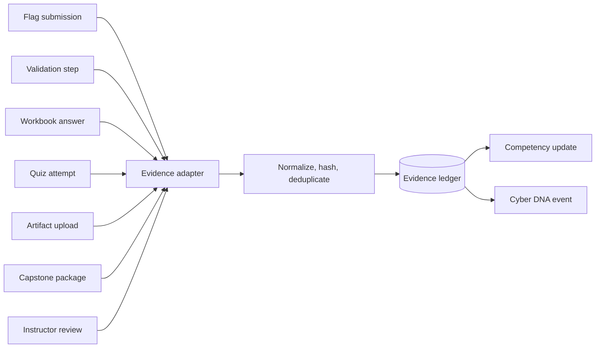

# Evidence Engine

Status: **Release 6.0 foundation implemented.** The append-only ledger,
competency links, review records, tenant backstop, and read/review API are in
place. Capstones, analytics, federation, and AI remain.

Most platforms measure completion. OpenCyberRange already records more than a
flag: attempts, hints, time, quiz scores, workbook answers, and review
decisions. Release 6 makes those signals a first-class **evidence record** that
can be rubric-scored, reviewed by an instructor, and fed into competency
updates.

The distinction is the whole point:

| Completion-only platform | Evidence-first platform |
|---|---|
| Student completed the lab | Student identified the persistence mechanism |
| | Student extracted the indicator of compromise |
| | Student documented the findings and the tool path |
| | Student completed or recommended remediation |

Completion says the learner reached the end. Evidence says what they can do.

## Evidence model

Every evidence record is append-only. A correction is a new record that
supersedes the old one; nothing is edited or deleted in place.

| Field | Required | Meaning |
|---|---|---|
| `evidence_id` | Yes | Stable identifier |
| `tenant_id` | Yes | Institution scope; never crosses a tenant |
| `learner_id` | Yes | Owner of the evidence |
| `source_type` | Yes | `flag`, `validation_step`, `workbook`, `quiz`, `artifact`, `capstone`, `instructor` |
| `source_id` | Yes | Lab, chapter, quiz, capstone, or review identifier |
| `competency_ids` | Yes | One or more taxonomy IDs |
| `criteria` | Yes | Rubric criteria this evidence addresses |
| `artifact` | Optional | URI, MIME type, size, and SHA-256 of the submitted file |
| `rubric_version` | Yes | Version of the rubric used to judge it |
| `confidence` | Yes | `low`, `medium`, or `high`, with a reason |
| `collected_at` | Yes | UTC timestamp |
| `provenance` | Yes | Tool, command family, harness run, or reviewer |
| `visibility` | Yes | Learner, instructor, or both |
| `status` | Yes | `collected`, `in_review`, `accepted`, `rejected`, `superseded` |
| `reviewer_id` | When reviewed | Instructor or reviewer |
| `review_notes` | When reviewed | Decision rationale |
| `formula_version` | Yes | Competency formula version used |

Design rules:

- Evidence never contains a secret, a plaintext flag, a password, or a VPN key.
- Evidence is tenant-scoped and follows the same RLS backstop as learner tables.
- Evidence collection never records keystrokes, shell history, mouse movement,
  or a packet capture of the learner's session.
- An evidence record can support several competencies, but each link carries
  its own criterion and weight.

## Evidence types

| Type | Example | Collection | Review |
|---|---|---|---|
| Flag | Correct per-session flag | Deterministic comparison against the session hash | Automatic |
| Validation step | Harness confirms the service is patched | Lab validation step | Automatic, then spot-check |
| Workbook | Analyst answer explaining the timeline | Workbook save | Instructor rubric review |
| Quiz | Knowledge check on log sources | Authored answer key | Automatic |
| Artifact | Timeline CSV, scan output, screenshot, report | Upload with hash | Instructor rubric review |
| Capstone | Findings, remediation plan, executive brief | Capstone package | Instructor plus second reviewer |
| Instructor | Observed teach-back or lab practical | Review form | Recorded by the instructor |

The first two are already produced by the platform. The workbook, artifact, and
capstone paths are the Release 6 extension.

## Rubric framework

A rubric is a versioned object:

```yaml
rubric: blue-team-timeline
version: "1.0"
criteria:
  - id: accuracy
    label: Timeline accuracy
    weight: 0.30
    levels:
      0: No credible timeline
      1: Partial timeline with material gaps
      2: Mostly accurate with minor gaps
      3: Accurate, ordered, and sourced
  - id: evidence
    label: Evidence and provenance
    weight: 0.30
    levels: ...
  - id: analysis
    label: Analysis and conclusions
    weight: 0.25
    levels: ...
  - id: communication
    label: Clarity for the intended audience
    weight: 0.15
    levels: ...
```

Rules:

- Weights sum to 1.00.
- Each level has an observable descriptor, not an adjective alone.
- A criterion names the evidence types that can satisfy it.
- Rubrics are versioned; an old evidence record keeps its rubric version.
- Two reviewers calibrate a sample each term; agreement is reported.
- A rubric can be shared through federation, but learner evidence cannot.

### Rubric registry

Versioned rubric files live in
`platform/backend/app/data/rubrics/`. The loader is
`app/services/rubrics.py`; it exposes `get_rubric(id, version)` and
`rubric_reference(id, version)` for evidence records. Validate the registry
before release:

```bash
python scripts/validate-rubrics.py
```

The initial registry contains `blue-team-timeline`,
`vulnerability-report`, and `capstone-brief`. Add a new version as a new file;
never edit a published version in place.

## Automated collection

Adapters normalize existing signals into evidence records:



Requirements:

- **Idempotent.** Replaying an event does not duplicate evidence.
- **Provenance-preserving.** The adapter records its name and version.
- **Fail-closed.** If the competency mapping or rubric version is missing, the
  record is stored as `collected` and not scored.
- **PII-minimal.** Artifact metadata stores a hash and a type, not a free-text
  learner narrative unless the learner explicitly submits it as the artifact.
- **Replayable.** A snapshot can rebuild the competency view at a point in time.

## Instructor review workflow

The review queue is a first-class surface, not an email inbox:

1. **Queue.** Evidence needing review is filtered by course, competency, rubric,
   age, and confidence.
2. **Claim.** A reviewer claims an item so two instructors do not score it twice.
3. **Judge.** The reviewer scores each rubric criterion and attaches notes.
4. **Decide.** Accept, reject, or request more evidence. Rejection requires a
   reason and a next step.
5. **Appeal.** A learner can request a second review; the appeal is recorded.
6. **Audit.** Every action records actor, time, rubric version, and before/after
   values.
7. **Moderation.** A sample is re-scored for calibration; disagreements are
   resolved by a lead reviewer.

Safeguards:

- Under-18 learners are excluded from instructor analytics and public surfaces;
  their evidence remains available to the assigned instructor for feedback.
- Reviewers see only their tenant and assigned courses.
- An instructor cannot review their own capstone submission.
- A rejected piece of evidence cannot silently lower a validated competency; the
  competency becomes provisional until new evidence arrives.

## Competency update

```text
Evidence -> dimension mapping -> weighted score -> coverage/confidence
         -> provisional or validated -> Cyber DNA event -> snapshot
```

- Only accepted evidence contributes to a score. Collected evidence appears as
  coverage but not as a validated result.
- Each dimension reports its evidence count.
- A competency with no documentation or communication evidence stays
  provisional even if the execution score is high.
- Cyber DNA receives a versioned event, not a raw artifact. It owns its own
  evidence ledger and snapshots.
- Recomputing a score never rewrites a historical snapshot; it creates a new
  snapshot with the current formula version.

## API and data model

Proposed endpoints:

| Endpoint | Purpose |
|---|---|
| `POST /api/evidence` | Record evidence from an adapter (service identity) |
| `GET /api/evidence/{id}` | Read one record with provenance |
| `GET /api/evidence?learner_id=` | Learner or instructor-scoped list |
| `POST /api/evidence/{id}/review` | Score, accept, reject, or request more |
| `GET /api/evidence/queue` | Reviewer queue |
| `POST /api/evidence/{id}/appeal` | Learner appeal |
| `GET /api/competencies/{id}/evidence` | Evidence behind a competency |
| `GET /api/evidence/export` | FERPA/GDPR export with artifact hashes |

Data model additions:

- `evidence_records` (append-only, tenant-scoped)
- `evidence_competencies` (many-to-many with criterion and weight)
- `evidence_reviews` (rubric scores, decision, notes, actor, time)
- `evidence_appeals`
- `rubric_definitions` (versioned, signed for federation)

Existing tables remain the activity source; the evidence ledger does not replace
`flag_attempts`, `lab_completions`, or `quiz_attempts`.

### Implemented foundation

Release 6.0 ships the first vertical slice:

- `evidence_records`, `evidence_competencies`, and `evidence_reviews`
  (migration `0052_evidence_engine`).
- Tenant scope on all three tables. The record derives its tenant from the
  learner; the link and review tables derive it from the record, so a client
  cannot choose a tenant.
- A PostgreSQL guard that rejects in-place changes to evidence content. Only
  `status`, `reviewer_id`, and `review_notes` may change when a review is
  recorded; deletion remains available to the account-erasure flow.
- Idempotent creation keyed by learner, source, rubric version, competencies,
  and artifact hash.
- Service rules for the rubric registry, taxonomy ids, artifact SHA-256,
  confidence, visibility, and review scoring.
- API endpoints: `POST /api/evidence`, `GET /api/evidence`,
  `GET /api/evidence/{id}`, `POST /api/evidence/{id}/review`,
  `GET /api/evidence/queue`, `GET /api/evidence/rubrics`, and
  `GET /api/competencies/{id}/evidence`.
- A reviewer surface at `/evidence-review` that shows the queue, the recorded
  rubric criteria and levels, prior decisions, and the decision form. The
  rubric catalogue is loaded from the versioned registry, so an old record is
  judged by the version it was collected with.
- Tests for idempotency, tenant and course scope, scoring, queue filtering,
  unknown rubric/competency rejection, and append-only content.

Not yet implemented: artifact upload and storage, appeals, and asynchronous
adapters that create evidence from flags or workbook saves. Those are the next
increments.

## Privacy and security

- Evidence is classified as learner data; artifacts inherit the highest
  sensitivity of their content.
- Artifact storage is encrypted at rest, scanned for malware, and retention-bound
  by the institution's policy.
- Erasure removes evidence rows and artifacts and records the deletion in the
  suppression ledger.
- No evidence is sent to an AI provider. The AI Mentor receives aggregate,
  cited summaries, not raw artifacts.
- The federation bundle schema has no learner fields; a boundary test asserts
  this on every export.

## Acceptance criteria

- A flag, a workbook answer, an artifact, and a capstone can each produce an
  evidence record with provenance and a rubric version.
- The review queue supports claim, score, accept, reject, appeal, and audit.
- A competency score reports evidence count, coverage, confidence, and formula
  version.
- Replaying an event does not duplicate evidence.
- Erasing a learner removes evidence and artifacts and leaves an audit record.
- No learner data appears in a federation or AI payload.
