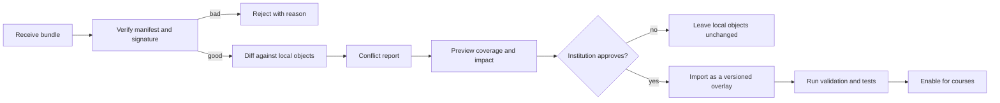

# Federation

Status: **Release 6.3, planning.**

Federation lets institutions share the parts of the curriculum that should be
shared while keeping the parts that must stay local. A university can adopt a
peer's competency definition, a college can reuse a capstone template, and a
consortium can publish a common rubric without any learner record leaving its
own platform.

The model is **exchange, not centralisation**:

```text
Institution A          Institution B          Institution C
own database           own database           own database
own learners           own learners           own learners
      \                    |                    /
       signed competency, content, rubric, capstone bundles
```

There is no shared learner database, no central identity, and no telemetry.

## Principles

- **Local-first.** Each institution runs its own OpenCyberRange and owns its
  learner data.
- **Definitions travel; learner records do not.** The bundle schema has no
  learner, grade, attempt, evidence, or artifact fields.
- **Signed and versioned.** Every bundle has a manifest, a content hash, a
  version, and a detached signature.
- **Explicit trust.** An institution imports only from a key it has added to its
  trust registry.
- **Preview before import.** Every import is a dry run with a diff and a
  conflict report.
- **Reversible.** An imported bundle is versioned and can be disabled without
  deleting local data.
- **Privacy by design.** Aggregate benchmarking is opt-in and separate from the
  bundle exchange.

## Exchange objects

| Object | Contents | Learner data |
|---|---|---|
| Competency bundle | Taxonomy, hierarchy, definitions, crosswalks | No |
| Contract bundle | Lab competency contracts, weights, reliability | No |
| Content bundle | Lab definitions, workbooks, images references, licences | No |
| Rubric bundle | Rubrics, performance levels, calibration notes | No |
| Capstone bundle | Role profile, objectives, lab set, assessments, deliverables | No |
| Badge bundle | Badge definitions, criteria, artwork, issuer metadata | No |
| Question bank | Authored questions and answer keys | No |

A bundle never contains a learner ID, an attempt, a completion, an evidence
record, an artifact, a grade, an email, or a VPN key. A boundary test asserts
this before a bundle is written.

## Bundle format

```text
bundle/
  manifest.json          # schema, version, publisher, objects, hashes
  manifest.sha256
  manifest.sig           # detached signature over manifest.sha256
  competencies.yaml
  contracts.yaml
  rubrics/
  capstones/
  content/
  badges/
  LICENSE
  PROVENANCE.md
```

`manifest.json` records:

| Field | Meaning |
|---|---|
| `schema` | Bundle schema version |
| `bundle_version` | Semantic version of this bundle |
| `publisher` | Institution name and key fingerprint |
| `created_at` | UTC timestamp |
| `objects` | Path, type, ID, version, SHA-256 |
| `requires` | Minimum platform and bundle versions |
| `licence` | Content licence and attribution |
| `signature` | Signature algorithm and key ID |

Identifiers are namespaced so two institutions can use the same short code
without colliding:

```text
ca.example.edu/competency/NET-031@1.2.0
ca.other.edu/competency/NET-031@1.1.0
```

The local platform resolves an imported competency to a local alias. Historical
evidence keeps the alias it was scored with.

## Trust and signing

- **Ed25519** detached signatures over the manifest hash.
- A **trust registry** maps a publisher and key fingerprint to an allowed object
  type and version range.
- **Revocation:** a signed revocation list marks a bundle or key as withdrawn.
  Imported objects can be disabled and re-reviewed.
- **Provenance:** the bundle records the human reviewer and the source for any
  third-party content.
- **No automatic trust on first use.** The first import from a publisher requires
  an explicit fingerprint confirmation.
- **Reproducibility:** the same bundle and platform version produce the same
  import diff.

## Import workflow



The diff reports:

- New objects, updated objects, and unchanged objects.
- Competency IDs that collide or require an alias.
- Contracts that reference a missing lab or a newer rubric.
- Capstones whose labs are not available locally.
- Licence or attribution changes.
- A coverage delta for each role profile.

Conflicts are resolved locally. The importer never overwrites a local edit
silently; it proposes a three-way diff with the local, incoming, and common
ancestor versions.

## Privacy and data sovereignty

- Learner data never leaves the institution, including in error logs, support
  bundles, or analytics.
- Federation does not require a shared identity provider or a central account.
- Optional consortium benchmarking uses aggregate, suppressed, opt-in metrics
  computed locally and shared as a separate signed report. It is not part of the
  bundle exchange.
- Data residency is the institution's choice; the platform does not phone home.
- A support bundle for a federation issue contains manifests and logs, not
  learner rows.

## Use cases

| Scenario | Shared | Kept local |
|---|---|---|
| Consortium adopts a common competency model | Taxonomy, contracts, crosswalks | Learners, evidence, grades |
| College reuses a peer's capstone | Capstone template, rubrics, lab list | Cohort, submissions, reviews |
| Programme publishes a detection rubric | Rubric and calibration notes | Learner artifacts |
| Institution licenses a question bank | Questions and answer keys | Attempts and scores |
| Multi-campus common badge | Badge definition and criteria | Issuer records and learner credentials |

## Governance

- **Federation registry:** publishers, keys, object types, and revocation.
- **Compatibility policy:** supported schema versions and migration notes.
- **Review board:** content provenance, licensing, and accessibility review.
- **Incident process:** a compromised key or a bad bundle is revoked, imported
  objects are disabled, and affected institutions are notified through the
  registry.
- **No central operator:** the registry can be a static signed index or a
  consortium-run service. It does not hold learner data.

## Acceptance criteria

- Two institutions exchange a competency bundle and a capstone template, import
  them with a diff, and validate a course locally.
- Every bundle is signed, versioned, and verified before import.
- A boundary test proves that no learner field can enter a bundle.
- A conflicting competency ID resolves through an alias without rewriting
  historical evidence.
- A revoked key or bundle can be disabled without deleting local data.
- A full export and import reproduces the local coverage report.
