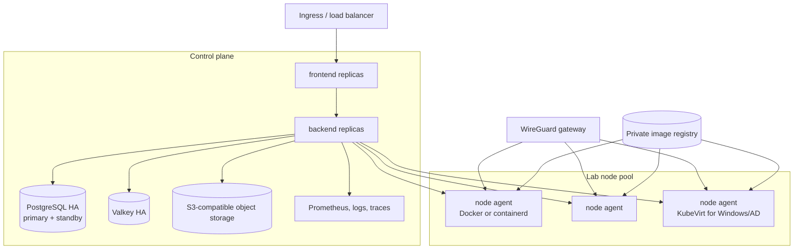

# HA and Kubernetes

Status: **Release 6.2, planning.** The single-host Compose profile remains the
reference deployment. This page defines the optional highly available profile
for institutions that need uptime, scale, or central operations.

Release 5 is explicitly single-host. The prior lab-pool analysis in
[`V3-HA-LAB-POOL.md`](V3-HA-LAB-POOL.md) lists the assumptions that break a naive
multi-host deployment: one Docker socket, a local Compose CLI, a local lab
mount, user-only session subnets, one WireGuard endpoint, local image tags, local
backups, and per-worker state. Release 6 removes those assumptions in phases.

## Goals

| Goal | Target |
|---|---|
| Control-plane availability | 99.9% during a teaching term |
| Evidence durability | No accepted evidence lost on a node or pod loss |
| Lab capacity | Add lab nodes without changing the application |
| Upgrade | Rolling control-plane upgrade with no learner-visible outage |
| Recovery | Documented RPO 15 minutes and RTO 1 hour, drilled |
| Single-host parity | The Compose profile remains fully supported |

## Reference topology

## Control plane

- **Frontend and backend are stateless.** JWT auth, DB-backed revocation, and a
  shared Valkey rate-limit store mean no session affinity is required.
- **PostgreSQL runs under an operator** (CloudNativePG or Patroni) with one
  primary, one synchronous standby, automated failover, and point-in-time
  recovery to object storage.
- **Valkey is replicated** and is not the source of truth. A Valkey outage
  degrades rate limiting and caching, not authentication or evidence.
- **Object storage** holds wiki builds, backups, and evidence artifacts with
  versioning and lifecycle rules.
- **Scheduler leader election** already uses a PostgreSQL advisory lock; the
  leader runs cleanup and snapshot jobs while other replicas serve requests.
- **Secrets** come from an external secret store; no secret is baked into an
  image or a ConfigMap.
- **Ingress** terminates TLS with cert-manager and preserves the existing
  security headers and CSP.

## Lab execution

Labs are not ordinary stateless pods. A session needs a privileged data plane,
per-session `/24` addressing, routing, WireGuard, and sometimes a VM. The
reference profile therefore uses a **dedicated lab node pool**:

- One or more nodes run a **node agent** that owns the container runtime and the
  session data plane. The control plane schedules *sessions*, not raw pods.
- **Docker or containerd** runs the lab services. A session is a Compose project
  or an equivalent namespace on one node.
- **KubeVirt** runs Windows, Active Directory, and other VM-based labs on nodes
  with nested virtualization.
- **WireGuard gateways** run on dedicated nodes or as a DaemonSet with explicit
  host networking. A session is assigned to the gateway that owns its endpoint.
- **Network isolation** is enforced with per-session bridges, iptables or nftables,
  and Kubernetes NetworkPolicy for platform traffic. The lab egress policy stays
  deny-by-default.
- **Images** are built centrally, signed, scanned, and pulled from a private
  registry. Nodes prebuild the current catalogue; a missing image is a scheduling
  failure, not a silent build at spawn time.
- **Scheduling** uses taints and tolerations, node affinity, and a session budget.
  A lab definition declares what it needs: Docker only, VM, privileged network,
  or a specific architecture.
- **Draining** a node migrates or stops its sessions with recorded evidence;
  accepted evidence is already durable in the control plane.

## Storage and backups

| Data | Store | Protection |
|---|---|---|
| Relational data | PostgreSQL HA | Streaming replication, PITR, daily logical dump |
| Session and rate-limit state | Valkey | Replica; rebuildable |
| Wiki builds | Object storage | Versioned, checksummed |
| Evidence artifacts | Object storage | Versioned, encrypted, retention-bound |
| Lab images | Registry | Signed, scanned, immutable tags |
| Backups | Object storage plus off-site | Encrypted, restore-drilled |

Restore drills run on a schedule and record the row counts and evidence counts,
not only "the job succeeded".

## Security

- Pod Security Admission restricted for the control plane; lab nodes are a
  separate trust zone.
- Non-root, read-only root filesystems, dropped capabilities, and seccomp for
  platform workloads.
- Network policies deny platform-to-lab and lab-to-platform traffic except the
  explicit session control path.
- Signed images and SBOMs; admission refuses unsigned control-plane images.
- Secrets are mounted from a secret store and rotated.
- Tenant isolation keeps the same RLS backstop; a shared cluster does not weaken
  it.
- The existing security headers, CSP, and egress firewall remain in force.

## Migration path

1. **Package the control plane** as a Helm chart or Kustomize overlay, with the
   same images and environment contract as Compose.
2. **Externalize state**: PostgreSQL, Valkey, object storage, and secrets.
3. **Add the lab node agent** and run one track on a lab node while the rest of
   the sessions stay on the single host.
4. **Move sessions by track** and validate the harness for each track.
5. **Cut over the ingress** and keep the Compose profile as the rollback.
6. **Drill** a node loss, a database failover, and a restore.

The migration is reversible until the final cutover. The single-host profile is
not deprecated.

## Observability

- Metrics: request latency, error rate, scheduler leader, database replication
  lag, Valkey health, session spawn latency, image cache hit, node capacity,
  evidence queue depth, and backup age.
- Logs: structured, tenant-tagged, and redacted; no flags or PII.
- Traces: request to database to session control, sampled.
- Alerts: control-plane availability, replication lag, backup age, certificate
  expiry, disk headroom, and evidence pipeline lag.

## Acceptance criteria

- A control-plane node can be lost without an outage beyond the failover window.
- A lab node can be drained without losing accepted evidence.
- Two backend replicas serve traffic with no session affinity.
- A rolling upgrade completes with no learner-visible outage.
- The restore drill meets RPO 15 minutes and RTO 1 hour.
- A lab session still enforces the egress policy and per-session isolation.
- The single-host Compose profile passes the same release checks.
