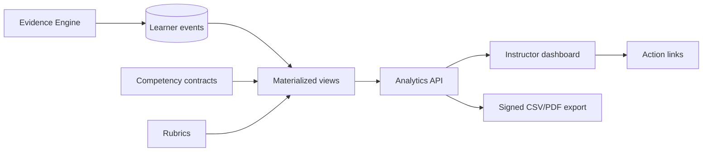

# Instructor Analytics

Status: **Release 6.1, planning.** This extends the Release 5 instructor
dashboard and programme reports; it does not replace them.

Release 5 answers "what happened in the last seven days" and "which exercise is
unhealthy". Release 6 answers the questions a programme lead, accreditation
reviewer, and teaching team ask at the end of a term:

| Question | Dashboard |
|---|---|
| How competent is the class, and how much evidence supports that? | Class Average Competency |
| Which domains are weakest, and is it a teaching gap or an evidence gap? | Weakest Domains |
| Which labs are failing learners, and why? | Most Failed Labs |
| How fast is the cohort developing? | Learning Velocity |
| Are we using the lab capacity we pay for? | Lab Utilization |
| Where do learners stop? | Drop-off Points |

Every dashboard is **aggregate**, **evidence-aware**, and **actionable**. None of
them ranks an individual learner.

## Design rules

- **Aggregate only.** No individual ranking, leaderboard, or "at risk" label.
  The instructor can open a learner record they are entitled to see, but the
  dashboard does not expose one.
- **Small-cohort suppression.** No aggregate is shown for fewer than 5 learners.
  A suppressed tile says so; it does not show a partial value.
- **Under-18 exclusion.** Learners who identify as under 18 are excluded from
  instructor analytics and public surfaces, consistent with Release 5 policy.
- **Coverage beside score.** Every score shows evidence count and coverage. A
  low score with no evidence is not a weak competency; it is an unmeasured one.
- **Confidence, not certainty.** Show the denominator, the interval where
  useful, and the formula version.
- **Action links.** Each tile links to a decision: assign practice, review
  evidence, inspect a lab, adjust a due date, or open the rubric.
- **Versioned definitions.** The metric dictionary is versioned; a historical
  report keeps the definition it used.

## Metric definitions

### 1. Class Average Competency

| Item | Definition |
|---|---|
| Population | Learners enrolled in the selected course, excluding under-18 and suppressed cohorts |
| Value | Mean and median competency score across validated and provisional competencies |
| Coverage | Share of competencies with at least one evidence record |
| Dimensions | Knowledge, execution, troubleshooting, documentation, communication |
| Confidence | Evidence count per dimension and per competency |
| Breakdown | By domain, category, and role profile |
| Source | Competency scores derived from the Evidence Engine |

A high average with low coverage is reported as **provisional**. The dashboard
does not hide the coverage behind the mean.

### 2. Weakest Domains

| Item | Definition |
|---|---|
| Value | Domains ordered by median score, lowest first |
| Qualifier | `no evidence` when coverage is below the threshold, `low evidence` when coverage is partial, `low score` only when coverage is sufficient |
| Denominator | Learners with evidence in the domain |
| Drill-down | Competencies in the domain, evidence counts, and the labs that teach them |
| Action | Assign a lab, open the workbook chapter, or review pending evidence |

The distinction matters: a domain with no evidence is a curriculum or adoption
gap, not a learner deficit.

### 3. Most Failed Labs

| Item | Definition |
|---|---|
| Failure rate | Learners with at least one attempt and no completion, divided by learners who started |
| Abandonment | Started, then no activity for the inactivity window |
| Attempts | Median attempts per learner, and the share with 3 or more |
| Hint pressure | Median hints per learner |
| Time | Median time to completion and time spent before abandonment |
| Technical failures | Spawn errors, image misses, network failures, and timeouts, reported separately |
| Action | Inspect the lab, review the workbook, adjust hints, or prebuild the image |

A lab can fail for a technical reason or a learning reason. The dashboard
separates them so the instructor does not rewrite a good lab because an image
was missing.

### 4. Learning Velocity

| Item | Definition |
|---|---|
| Velocity | Competency points gained per active week, using accepted evidence |
| Time to first completion | Median hours from course start to first lab completion |
| Completion cadence | Completions per active learner per week |
| Trend | Four-week rolling direction, with the evidence count |
| Normalisation | Starting competency level and prior evidence, so a beginner cohort is not compared unfairly with an advanced one |
| Action | Identify a plateau and suggest a practice set or a stretch lab |

Velocity is a trend, not a race. The dashboard does not rank learners or
cohorts against each other.

### 5. Lab Utilization

| Item | Definition |
|---|---|
| Starts | Lab sessions started in the window |
| Active learners | Distinct learners with a session |
| Seat-hours | Session duration summed across learners |
| Capacity | Live RangeBox cap plus Docker lab capacity |
| Utilization | Seat-hours divided by available seat-hours |
| Idle sessions | Running with no learner activity for the inactivity window |
| Spawn latency | p50 and p95 time to a ready lab |
| Image health | Prebuilt image coverage and cache hit rate |
| Action | Free idle capacity, prebuild missing images, or adjust the cap |

This is the dashboard that proves the institution is using the capacity it paid
for, and the one that warns before an event.

### 6. Drop-off Points

The funnel is cohort-level:

```text
Enrolled -> Activated -> Lab opened -> First action -> First flag attempt
         -> First completion -> Workbook evidence -> Capstone started
         -> Capstone submitted -> Capstone reviewed
```

| Item | Definition |
|---|---|
| Conversion | Learners reaching stage N divided by learners reaching stage N-1 |
| Drop-off | The largest conversion loss, with the stage and the affected labs |
| Time | Median time between stages |
| Cause hints | Spawn failures, missing prerequisites, no workbook, no evidence review |
| Action | Fix the friction: a broken lab, a missing hint, an unassigned workbook, or a review backlog |

The dashboard reports where the cohort stops. It does not publish an individual
learner's path.

## Additional tiles

| Tile | Purpose |
|---|---|
| Evidence coverage | Share of competencies with accepted evidence, by course |
| Review backlog | Evidence waiting for instructor review, by age and rubric |
| Rubric calibration | Agreement between reviewers on a sampled set |
| Intervention queue | Learners with a specific, actionable need, visible only to the assigned instructor |

The intervention queue is a private instructor surface. It is not a public
"struggling students" list and does not feed a leaderboard.

## Architecture



- **Source of truth:** evidence, completions, attempts, sessions, quizzes, and
  competency contracts.
- **Views:** materialized, refreshed every 5-15 minutes; a manual refresh is
  available for a course.
- **Performance:** an aggregate dashboard for 200 learners must load under 2
  seconds at p95.
- **Caching:** per-course cache with an explicit invalidation on evidence review
  and course changes.
- **Exports:** reuse the signed `report_exports` pattern (report ID, SHA-256,
  HMAC, verification endpoint).
- **Tenancy:** every query is tenant-scoped; the analytics role is read-only.

## Academic value

- **Early intervention without surveillance.** The instructor sees a cohort
  pattern and a private action queue, not a ranked list of learners.
- **Constructive alignment evidence.** Coverage and weakest-domain views show
  whether the assessment actually exercised the outcomes.
- **Accreditation and programme review.** Term-level competency, velocity, and
  utilization evidence support programme improvement and accreditation files.
- **Equity.** Suppression and under-18 exclusion prevent small groups from being
  identified; coverage prevents "no evidence" from being read as "no ability".
- **Workload.** The review backlog and rubric calibration tiles make the
  instructor's own workload visible.

## Acceptance criteria

- All six dashboards load from live data for a 200-learner course under 2
  seconds at p95.
- Every tile reports its denominator, coverage, and formula version.
- Suppression and under-18 exclusion are enforced in the API, not only the UI.
- No dashboard exposes an individual learner's rank, score, or path.
- The action links reach the relevant lab, evidence queue, or assignment.
- Exports are signed and verifiable with the existing report verification
  endpoint.
- A historical report renders with the metric definition version it used.
