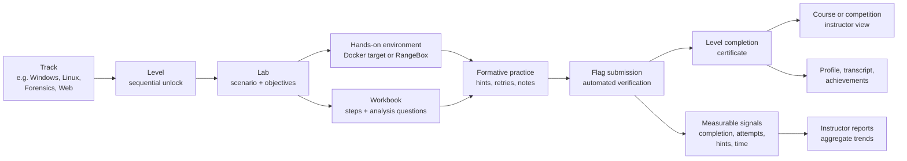
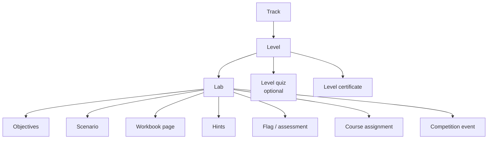

# Learning framework

OpenCyberRange is built around a scaffolded, practice-first progression. Each
track is a sequence of levels; each level is a small set of hands-on labs; each
lab combines a realistic scenario, a runnable environment, a workbook
walkthrough, and an automated flag check.

## The learning loop

| Stage | What the learner does | What the platform provides |
|---|---|---|
| Orient | Reads the track and level description | Clear prerequisites, estimated time, difficulty, and outcomes |
| Explore | Opens a realistic scenario | Isolated environment, target services, evidence files, or browser desktop |
| Practise | Follows the workbook or works independently | Step-by-step walkthrough, commands, screenshots, and analysis prompts |
| Check | Submits a flag or answer | Immediate automated feedback; attempts and hints are recorded |
| Consolidate | Reviews the chapter and analysis questions | Workbook review, explanation, and reflection prompts |
| Progress | Completes the level | Certificate, track progress, achievements, and transcript entry |
| Extend | Joins a course or competition | Instructor assignments, scoreboards, reports, and time-boxed events |

## Design principles

- **Scaffolded progression.** Levels unlock in order. A learner sees the next
  level only after completing the current one, so the difficulty curve is
  explicit and the prerequisites are real.
- **Active learning.** Every lab ends in a concrete action: a flag, a recovered
  artefact, a configuration change, or a written finding. The workbook is a
  guide, not a substitute for doing the work.
- **Immediate feedback.** Flag checks are automated and stored as hashes.
  Attempts, hints, and time are recorded so learners and instructors can see
  effort, not just the final answer.
- **Workbook and environment together.** Each lab pairs a runnable target with a
  written walkthrough and analysis questions. The workbook is available in the
  browser, so learners on shared or low-spec devices can follow along.
- **Assessment at the level.** A certificate is issued only when every visible
  exercise in a level is complete. Capstones and final assessments sit in the
  capstone level rather than being mixed into introductory levels.
- **Instructor oversight.** Courses assign labs by week, show completion and
  attempt data, and generate reports. Instructors can reset a learner's lab,
  reorder assignments, and archive a course.
- **Inclusive by default.** Browser-first paths, synthetic content, no public
  ranking of individual learning outcomes, and a celebration wall that lets
  learners choose a real name, username, or anonymous label.
- **Evidence, not claims.** The platform records completion, attempts, hints,
  time, quiz scores, and certificates. These are activity signals, not measures
  of ability, and are not used for hiring, promotion, or discipline.

## Curriculum model

## Roles and views

| Role | Primary view | Capabilities |
|---|---|---|
| Student | Dashboard, tracks, active lab, profile | Browse tracks, launch labs, submit flags, use hints, earn certificates, download transcript |
| Instructor | Instructor dashboard, courses | Create courses, assign labs, enroll students, monitor progress, reset labs, export reports |
| Administrator | Admin panel | Users, sessions, VPN peers, exercises, curriculum, settings, backups, audit log |

## Measuring the framework

The platform records the following signals per learner and per lab:

- completion status and timestamp;
- flag attempts and whether the submitted flag was correct;
- hints used;
- time spent in the lab;
- quiz score and pass/fail where a level quiz exists;
- certificates issued per completed level;
- course enrolments and assignment completion;
- competition participation and event-scoped scores.

Reports and the PDF transcript aggregate these signals. They are intended to
support formative feedback and course administration, not to rank learners
publicly or make high-stakes decisions.

## Related documents

- [System architecture](ARCHITECTURE.md)
- [NICE mapping matrix](NICE-MAPPING.md)
- [Survey privacy and consent](SURVEY-PRIVACY.md)
- [REB-ready survey package](research/REB-SURVEY-PACKAGE.md)
