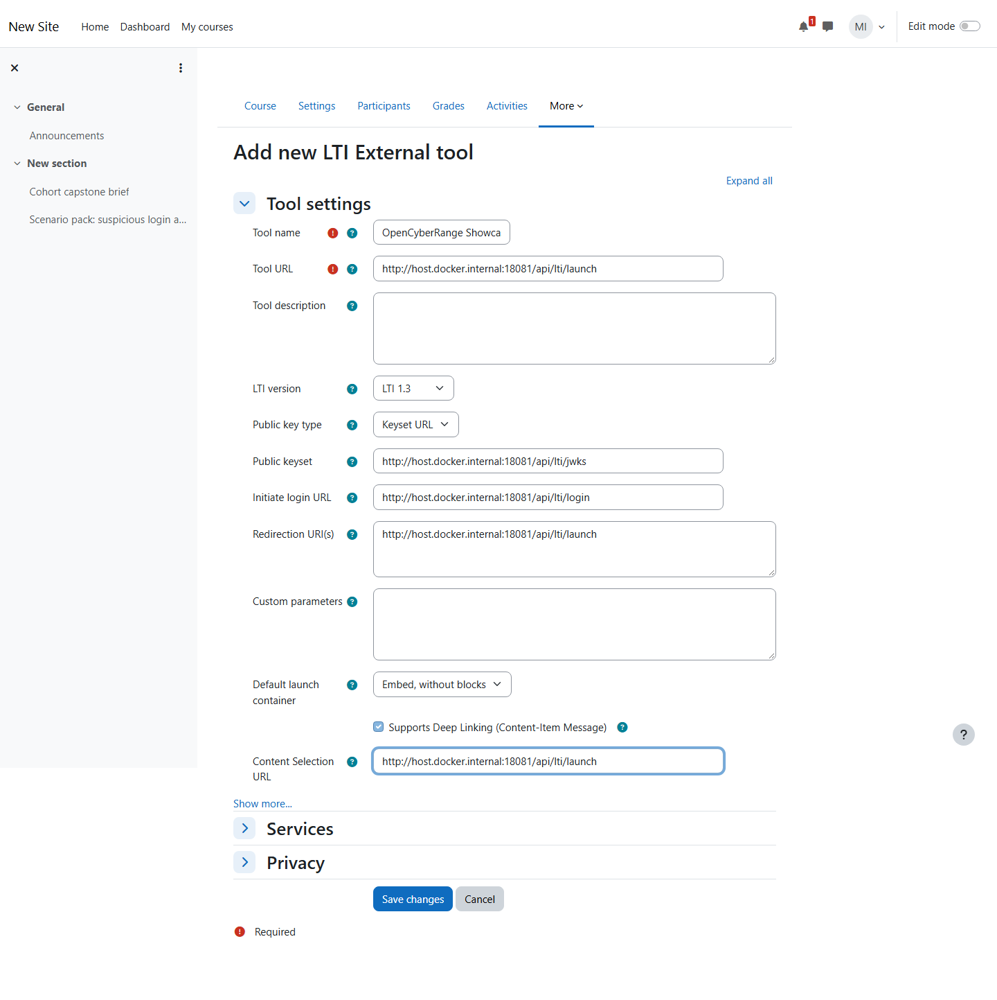
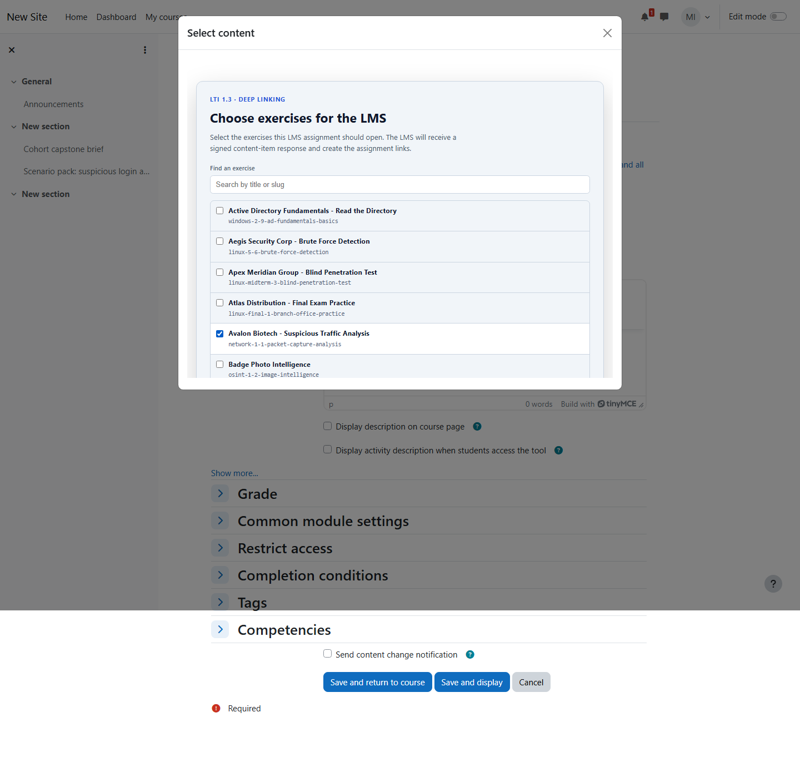
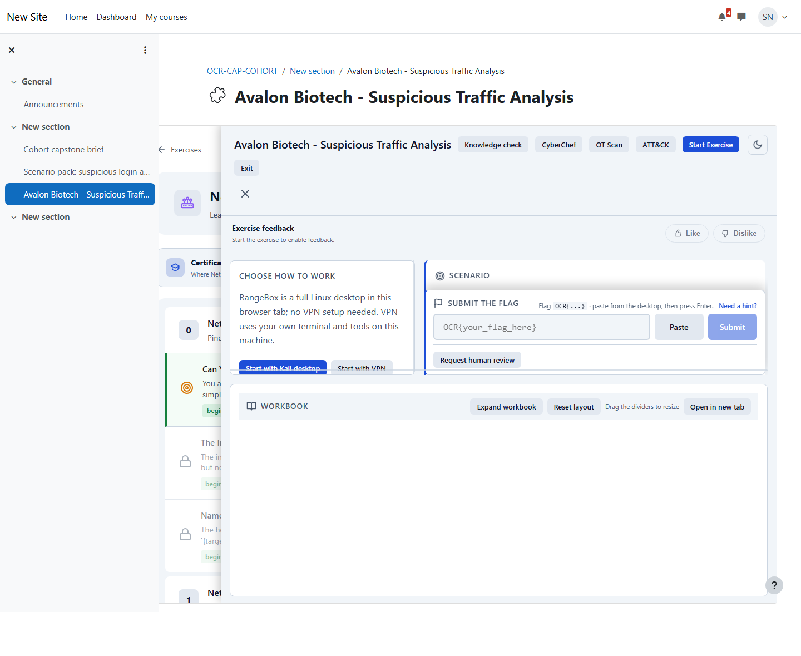
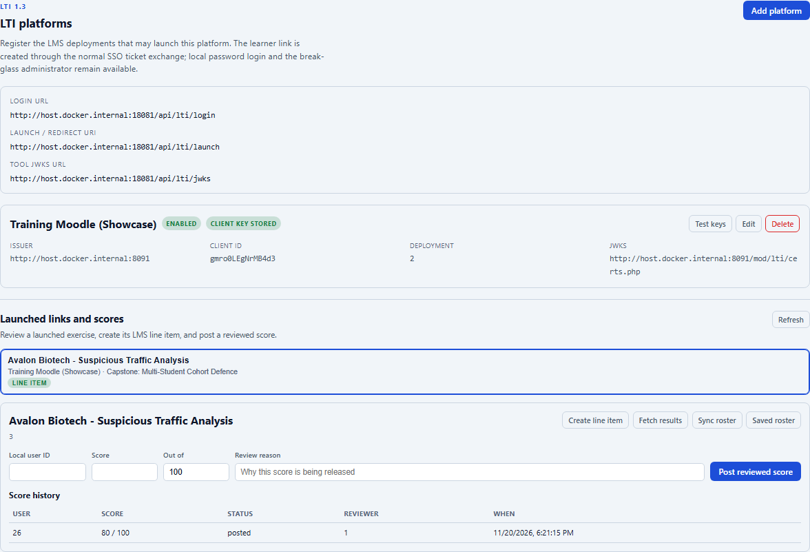
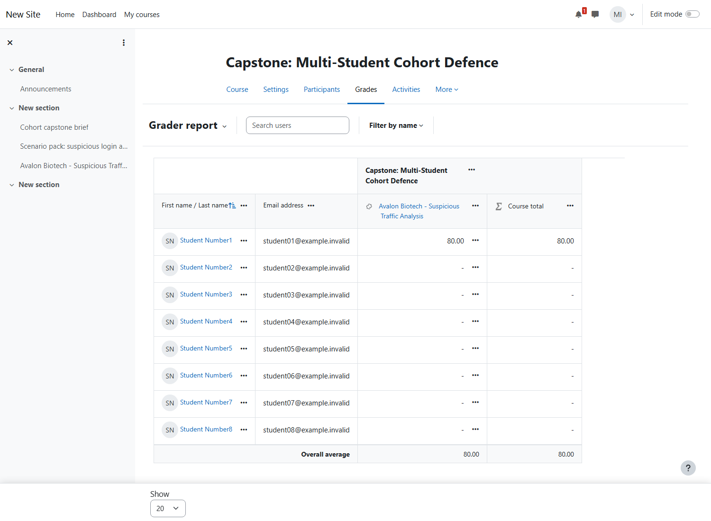
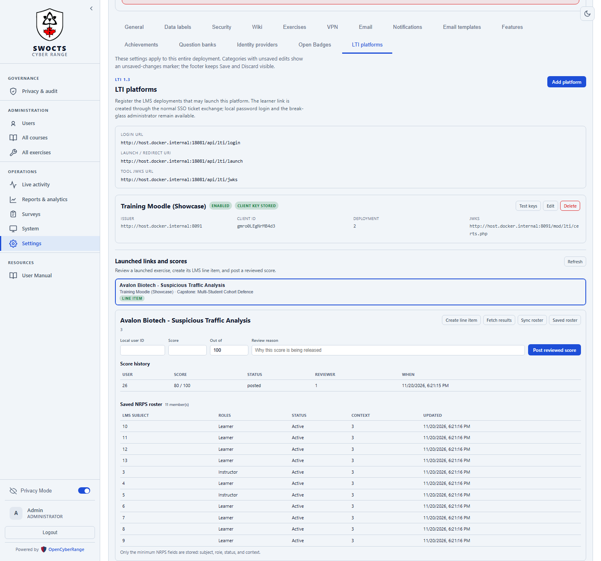

# Moodle LTI 1.3 showcase

**Date:** 20 November 2026

**Scope:** the dev-only Moodle training stack (`deploy/ecosystem-test`) and the
local Release 5 OpenCyberRange instance. Production was not involved.

This is a worked, end-to-end demonstration of the LTI 1.3 integration for a
technical audience. It covers the complete loop an institution cares about:

1. an instructor configures the tool and selects an exercise through **Deep
   Linking**;
2. a learner launches that exercise from the Moodle course and lands directly in
   the OpenCyberRange exercise workspace;
3. an administrator reviews the result in OpenCyberRange and **posts a score back
   to the Moodle gradebook** with AGS 2.0;
4. OpenCyberRange syncs the course roster through **NRPS 2.0**, storing only the
   minimum fields.

The design contract and security rules are in [`LTI.md`](LTI.md). The training
stack is described in [`TRAINING-ECOSYSTEM.md`](TRAINING-ECOSYSTEM.md).

## What was verified

| Check | Result | Evidence |
|---|---|---|
| LTI 1.3 platform registration | **PASS** | OpenCyberRange fetched Moodle's JWKS: `Fetched 1 signing key(s)` |
| Deep Linking picker | **PASS** | Instructor selected one of 179 active exercises from inside Moodle |
| Content-item return | **PASS** | Moodle created the activity with the selected lab URL |
| Learner launch | **PASS** | `student01` launched the activity and landed on the exercise workspace |
| Course-only exercise | **PASS** | The selected `visibility = course` exercise opened without a local course enrolment, using the signed launch grant |
| Account linking | **PASS** | Moodle subject `6` linked to local user `student01`; no standalone password prompt |
| AGS line item | **PASS** | Line item created for the launched resource link |
| Reviewed score passback | **PASS** | `80 / 100` posted; Moodle gradebook shows `80.00` |
| NRPS roster | **PASS** | 11 members synced and shown in a minimum-field table; only subject, role, status, and context stored |
| Production impact | **NONE** | No production host, credential, or identity provider was used |

## Walkthrough

### 1. Register the tool in Moodle

Moodle 5 requires a course-level tool definition before an activity can be
created. The instructor adds the tool with the LTI 1.3 keyset, login URL, and
redirect URI, and enables Deep Linking, grade sync, and membership services.



### 2. Select an exercise through Deep Linking

When the instructor creates the activity, **Select content** opens the
OpenCyberRange picker inside the Moodle activity form. The picker is a signed
LTI Deep Linking session bound to the launching instructor.



The instructor picks **Avalon Biotech - Suspicious Traffic Analysis**. Moodle
receives a signed `LtiDeepLinkingResponse` and stores a resource link whose
target is the OpenCyberRange launch URL for that exercise.

### 3. Learner launch

`student01` opens the course activity. The LTI launch verifies the issuer,
client, deployment, nonce, and state, links the Moodle subject to a local
OpenCyberRange account, and redirects into the exercise.



The exercise workspace is framed by Moodle and shows the launch-specific action.
The learner does not see a separate OpenCyberRange login.

### 4. Review and post the score

OpenCyberRange records the launched resource link. For this pass, the line item
and reviewed score were posted through the LTI admin API, which exposes the same
action as **Admin -> Settings -> LTI platforms**. The panel below shows the
resulting score ledger. The score is written to the append-only local ledger
after the attempt, so a failed passback remains visible and retryable.



### 5. Gradebook result

The score appears in the Moodle gradebook for the course.



### 6. Roster sync

For this pass the NRPS membership page was pulled through the admin API, then
loaded in the panel with **Saved roster**. OpenCyberRange persists the minimum
allow-listed fields only: LMS subject, role, status, and context ID. No name,
email address, phone number, or demographic field is stored.



## Reproduce it locally

In this demo the two user-facing endpoints were:

| System | Local URL |
|---|---|
| Moodle | `http://host.docker.internal:8091` |
| OpenCyberRange | `http://host.docker.internal:18081` |

Use whichever name resolves to the Docker host on the demo machine. Replace it
with the institution's HTTPS hostnames for a real deployment.

For a separate public staging Moodle on `moodle.swocts.com`, use
[`deploy/moodle-staging/README.md`](../deploy/moodle-staging/README.md). That
stack is isolated from this training lab and must not be connected to
OpenCyberRange production.

Use the dev-only stack described in
[`TRAINING-ECOSYSTEM.md`](TRAINING-ECOSYSTEM.md). Start Moodle and the
OpenCyberRange dev stack first, then run one command from the repository root:

```bash
python scripts/ecosystem_seed/seed_showcase.py
```

Wrappers are available for both shells:

```bash
bash scripts/ecosystem_seed/seed_showcase.sh   # Linux, WSL, Git Bash
pwsh scripts/ecosystem_seed/seed_showcase.ps1  # Windows PowerShell
```

The command is idempotent. It:

- seeds the Moodle training users and courses;
- seeds the OpenCyberRange capstone courses, staff, learners, and lab assignments;
- creates the Moodle 5 course-level LTI tool in `OCR-CAP-COHORT`;
- creates the pre-linked **Avalon Biotech - Suspicious Traffic Analysis** activity;
- registers the matching OpenCyberRange platform and generates a tool RSA key
  on first use;
- relaxes Moodle's cURL SSRF allow-list for the private Docker host, because the
  local Moodle container must fetch JWKS and call AGS/NRPS on
  `host.docker.internal`.

The last item is a dev-only change. The seed prints a warning and should never
be run against a production Moodle.

Useful overrides:

| Variable | Default |
|---|---|
| `MOODLE_ISSUER` | `http://host.docker.internal:8091` |
| `MOODLE_INTERNAL_URL` | the issuer, with loopback mapped to `host.docker.internal` |
| `OCR_PUBLIC_URL` | the container's `PUBLIC_BASE_URL` |
| `OCR_INTERNAL_URL` | the public URL, with loopback mapped to `host.docker.internal` |
| `MOODLE_LTI_COURSE` | `OCR-CAP-COHORT` |
| `MOODLE_LTI_ACTIVITY_NAME` | `Avalon Biotech - Suspicious Traffic Analysis` |
| `MOODLE_LTI_LAB_SLUG` | `network-1-1-packet-capture-analysis` |
| `TRAINING_PASSWORD` | `TrainLab!2026#Student` |

The course tool the seed creates is the same one you can add by hand from
**Course -> More -> LTI External tools -> Add tool**:

| Moodle field | Value |
|---|---|
| Tool URL | `<ocr-public>/api/lti/launch` |
| LTI version | `LTI 1.3` |
| Public key type | `Keyset URL` |
| Public keyset | `<ocr-internal>/api/lti/jwks` |
| Initiate login URL | `<ocr-public>/api/lti/login` |
| Redirection URI(s) | `<ocr-public>/api/lti/launch` |
| Supports Deep Linking | enabled |
| Content Selection URL | `<ocr-public>/api/lti/launch` |
| Grade sync | `Use this service for grade sync and column management` |
| Memberships | `Use this service to retrieve members' information` |

The existing `seed_lti.sh` remains available when you only want to refresh the
LTI tool, activity, and platform without reseeding the courses.

### Local Docker Desktop adjustments

The screenshots use `host.docker.internal` because Moodle and OpenCyberRange
run in separate compose projects. For a local-only demo:

- publish the OpenCyberRange frontend on an interface the browser and Moodle can
  both reach, and use `host.docker.internal` for the browser-facing URLs;
- add the local Docker host origin to the dev-only LTI `frame-ancestors` and
  `form-action` policy, because Moodle frames the picker and launch callback over
  HTTP. The checked-in policy already allows loopback HTTP for local LMS
  testing; `host.docker.internal` needs the same local-only allowance.

The dev-stack repository includes a ready-made snippet for the last item. If the
frontend container is recreated, reapply it:

```bash
docker cp deploy/ecosystem-test/lti-embed-headers.host-docker.conf \
  ocr-r5-frontend:/etc/nginx/snippets/lti-embed-headers.conf
docker exec ocr-r5-frontend nginx -s reload
```

The seed handles Moodle's cURL allow-list. These two adjustments remain
deployment configuration, not production configuration. A real deployment uses
HTTPS hostnames and does not need them.

### Demo accounts

The Moodle seed uses `TRAINING_PASSWORD` for learners and staff. The
OpenCyberRange seed creates the matching local staff and learner accounts. Set
the password in the environment; never commit a working credential.

### Teardown

This demo relaxes local-only settings so the two compose projects can talk to
each other. After the showcase:

1. set `MOODLE_BIND=127.0.0.1` in `deploy/ecosystem-test/.env` and recreate
   Moodle;
2. recreate the OpenCyberRange frontend without the showcase port override and
   restore `PUBLIC_BASE_URL`, `FRONTEND_BASE_URL`, and `CORS_ORIGINS` to the
   loopback URL;
3. remove the local `host.docker.internal` allowance from the LTI
   `frame-ancestors` / `form-action` policy;
4. delete the demo platform and course activity, or wipe the training stack with
   `docker compose down -v` when the synthetic data is no longer needed.

Do not reuse the demo admin password outside this disposable stack.

## Evidence snapshot

The demo left the following local records, which can be inspected in the
OpenCyberRange database or through the admin LTI API:

| Record | Value |
|---|---|
| LTI platform | `id=19`, issuer `http://host.docker.internal:8091`, client `gmro0LEgNrMB4d3`, deployment `2` |
| Launched link | `id=5`, resource link `3`, context `3`, title `Avalon Biotech - Suspicious Traffic Analysis` |
| Reviewed score | `id=8`, local user `26`, `80/100`, status `posted`, reviewer `1` |
| NRPS roster | 11 saved members with subject, role, status, and context only |

## Launch-grant visibility

A verified LTI launch grant is scoped to one user and one exercise and expires
after ten minutes. It may open a `visibility = course` or `pending_public`
exercise for the provisioned LMS user even when that user has no local course
enrolment, because the instructor deliberately selected the exercise through
Deep Linking.

The grant does not override the inactive, draft-owner, or minor/OSINT safety
rules. The regression test is in
[`platform/backend/tests/test_lab_visibility.py`](../platform/backend/tests/test_lab_visibility.py).

## Known limitations

- **LMS coverage:** this pass covers Moodle 5. Canvas and Brightspace remain
  recommended staging targets before a broad compatibility claim.
- **Local HTTP:** the demo uses HTTP between Moodle and OpenCyberRange on the
  Docker host. Production LTI must use HTTPS.
- **Deep Linking catalogue:** the picker lists active exercises. A production
  institution may want to narrow it to the courses and tracks its instructors
  are authorised to assign.

## Related evidence

- [`LTI.md`](LTI.md) - design contract, data model, security rules, and release
  gate.
- [`TRAINING-VALIDATION.md`](TRAINING-VALIDATION.md) - the wider training-stack
  validation record, including the earlier Moodle launch pass.
- [`TRAINING-ECOSYSTEM.md`](TRAINING-ECOSYSTEM.md) - the dev-only stack, ports,
  seeds, and TLS front.
- [`../deploy/ecosystem-test/README.md`](../deploy/ecosystem-test/README.md) -
  the compose stack and isolation rules.
- [`../platform/backend/tests/test_lab_visibility.py`](../platform/backend/tests/test_lab_visibility.py) -
  the launch-grant visibility regression tests.
