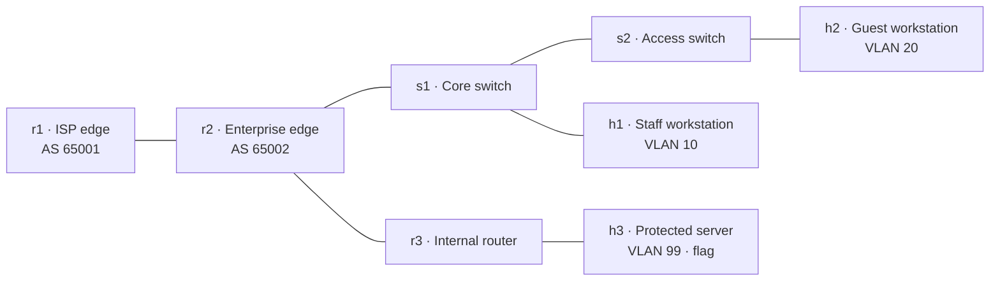

# Advanced network sandbox (Mininet) — design note

Status: **design only; deferred**
Proposed lab: `network-12-3-enterprise-topology-sandbox`
Audience: advanced learners who have completed the Network Foundations, packet
analysis, and firewall labs.

This note records the Mininet sandbox design for an optional infrastructure
showcase. It is not implemented in the current release. It is the recommended
first step before considering Containerlab, GNS3, EVE-NG, or Cisco CML.

## Goal

Give learners a visible, interactive enterprise topology with switches, routers,
VLANs, an interior gateway protocol, an exterior gateway protocol, a firewall,
and a protected server. The learner maps the topology, finds a route leak, proves
the path to the protected server, and writes the fix.

It is a showcase and analysis lab, not a beginner configuration exercise. The
topology is pre-built and deterministic so the lab can be validated and reset.

## Why Mininet

| Reason | Benefit |
|---|---|
| One container | No VM, no bare-metal network appliance, no vendor image |
| Linux namespaces | Real routes, interfaces, bridges, VLANs, and firewall rules |
| Open vSwitch | Real L2 forwarding, trunk ports, and VLAN tags |
| FRRouting | Real OSPF, BGP, prefix lists, and route maps |
| nftables | Real stateful firewall and NAT policy |
| No Docker socket | The lab cannot create or control host containers |
| No host networking | Topology traffic stays inside the lab container |
| Reset by recreation | A student cannot leave the topology in a broken state |

The trade-off is that it is Linux networking, not Cisco/Juniper CLI. That is the
right trade for a first showcase; vendor CLI belongs in a later Containerlab or
GNS3 profile.

## Topology



### Addressing

| Segment | Prefix | Notes |
|---|---|---|
| Staff VLAN 10 | `10.10.10.0/24` | h1, s1 |
| Guest VLAN 20 | `10.20.20.0/24` | h2, s2 |
| Protected VLAN 99 | `10.99.99.0/24` | h3 |
| Edge–core | `10.0.1.0/30` | r2–r3 |
| Edge–ISP | `10.0.2.0/30` | r2–r1 |
| Simulated ISP | `198.51.100.0/30` | documentation range |

All addresses are documentation ranges. The container's management address is
on the existing per-session bridge (`10.100.x.0/24`); the internal topology uses
separate namespaces and does not overlap.

## The fault

The enterprise edge (`r2`) accepts a more-specific route for the protected
prefix from the simulated ISP and does not apply an inbound prefix filter. The
internal router (`r3`) also has one overly broad nftables rule for the guest
zone.

The learner can:

1. Read the BGP table on `r2` and see `10.99.99.0/24` learned from the ISP.
2. Trace from h2 and see traffic leave through the ISP instead of the internal
   path.
3. Reach the protected server with `curl` and recover the flag.
4. Fix it with an inbound prefix filter/route map on `r2`, a default-deny rule
   on `r3`, or both.
5. Explain why the more-specific route won and why the firewall alone was not
   enough.

The flag is reachable in the pre-built flawed topology, so the lab tests are
deterministic. The remediation is a written exercise; a separate "fix and
verify" lab can use a checker endpoint later.

## Student flow

1. SSH from RangeBox to `netlab.lab` as the training user.
2. Run `netlab net`, `netlab nodes`, and `netlab links` to map the topology.
3. Inspect OVS VLANs with `ovs-vsctl show` and `ovs-appctl fdb/show`.
4. Inspect routes with `vtysh -c 'show ip ospf neighbor'` and
   `vtysh -c 'show ip bgp'`.
5. Trace from h2 with `ip netns exec h2 traceroute 10.99.99.10`.
6. Read the nftables policy on r3.
7. Prove the path and recover the flag.
8. Write the filter/policy fix and the explanation.

The workbook supplies exact commands and a topology diagram. Hints scaffold
mapping → routing → path → fix; none contains the flag.

## Runtime design

One service in the lab Compose file:

```yaml
services:
  netlab:
    build:
      context: ./containers/netlab
      dockerfile: Dockerfile
    hostname: netlab
    labels:
      ip_offset: "96"
    environment:
      FLAG: "OCR{...}"
      TRAINING_USER: "analyst"
      TRAINING_PASSWORD: "Netlab2026"
    cap_add:
      - NET_ADMIN
      - NET_RAW
      - SYS_ADMIN
    devices:
      - /dev/net/tun
    read_only: true
    tmpfs:
      - /run:size=64m
      - /tmp:size=64m
    security_opt:
      - no-new-privileges:true
    mem_limit: 2g
    cpus: 1.5
    pids_limit: 256
    restart: unless-stopped
```

The image is a reviewed, prebuilt `ocr-lab/network-sandbox` image. It is not
built on the network-lab host and never accepts user-supplied images.

The entrypoint:

1. Starts `openvswitch-switch`.
2. Builds the namespace topology with the Mininet Python API.
3. Configures OVS VLANs, FRR, nftables, and the protected HTTP service.
4. Writes `/run/netlab/topology.json` and starts the `netlab` helper.
5. Starts `sshd` for the `analyst` user.
6. Keeps the topology process alive; the container health check probes SSH and
   the management health endpoint.

Students do not need the Mininet CLI for the first lab; `ip netns`,
`ovs-vsctl`, and `vtysh` are the teaching tools. A `netlab` helper provides
topology discovery without exposing implementation details.

## Host profile and scheduler

This lab must not run in the general lab pool. Add a host capability:

- Host flag: `OCR_NETWORK_LAB=true`.
- Lab metadata: `requires_network_lab: true` (or a generic `capabilities`
  list).
- Scheduler: place the lab only on a host with the flag; return a clear
  "network lab host unavailable" message otherwise.
- Capacity: one or two sandboxes per 16 GB host; measure before setting a
  default. Pre-pull the image; do not build on demand.
- Teardown: remove the container, its namespaces, and the per-session bridge as
  usual.

`requires_kvm` is not needed because there are no VMs. This is a separate
capability from KVM.

## Security controls

`SYS_ADMIN` is the significant change. The general lab pool forbids privileged
mode, host networking, and the Docker socket; this profile keeps those
prohibitions and adds isolated capabilities on a dedicated host.

| Control | Requirement |
|---|---|
| Host isolation | Dedicated network-lab host; no other tenant workloads |
| Host networking | Never use `network_mode: host` |
| Docker socket | Never mount it |
| Capabilities | `NET_ADMIN`, `NET_RAW`, `SYS_ADMIN` only; drop the rest |
| Root filesystem | Read-only with tmpfs for `/run`, `/tmp` |
| Privilege escalation | `no-new-privileges`; no setuid helpers |
| Seccomp/AppArmor | Default Docker profile plus a reviewed custom profile |
| Resource limits | 2 GB, 1.5 CPU, 256 PIDs, per-session network |
| Image supply chain | Prebuilt, reviewed, pinned digest; no user images |
| Teardown | Destroy namespaces and container; no host state |
| Monitoring | Host-level audit for unexpected mounts, namespace escapes, and network changes |

Add a threat-model row when implemented: "lab → network-lab host: a
`SYS_ADMIN` container escapes its namespace or alters host networking." The
residual risk is higher than the general pool and must be accepted explicitly.

## Tests

The lab test steps run from the platform test runner on the session bridge and
use the training credentials:

1. Management health endpoint returns `200`.
2. SSH as `analyst` works.
3. `vtysh -c 'show ip bgp'` contains the leaked protected prefix.
4. A trace from h2 shows the ISP next hop.
5. `ip netns exec h2 curl` returns the flag.
6. The last step expects the `OCR{...}` token.

The test runner must have `sshpass` or a key. The credentials section in
`lab.yaml` supplies the training user and password; the test steps use
`{cred.analyst.user}` and `{cred.analyst.pass}`.

## Workbook outline

`Workbook/CH_NET13_Network_Sandbox/`

1. Introduction: topology, addressing, and safe lab rules.
2. Map the topology: `netlab`, OVS, namespaces.
3. Read the routing: OSPF, BGP, prefix lists.
4. Follow the path: traceroute, conntrack, nftables.
5. Recover the token and write the fix.
6. Chapter review: route leaks, default-deny, and defense in depth.

Include a Mermaid topology, an addressing table, exact commands, analysis
questions, and a remediation section. No screenshots of real systems.

## Licensing and supply chain

- Mininet: BSD-3-Clause
- Open vSwitch: Apache-2.0
- FRRouting: GPL-2.0
- nftables: GPL-2.0
- OpenSSH: BSD
- Ubuntu/Debian base: package licences

Add all of these to `THIRD_PARTY_NOTICES.md`, the About inventory, and the
SBOM. No vendor network images are bundled, so there is no Cisco/Juniper
redistribution obligation. If Containerlab is added later, vendor images remain
operator-supplied and separately licensed.

## Alternatives

| Alternative | When to choose it |
|---|---|
| Compose-native FRR/firewall topology | If `SYS_ADMIN` is not approved; no configurable switch, but real routing and firewall policy |
| Containerlab on a dedicated host | If vendor-like NOS CLI is required; needs Docker access and licensed images |
| GNS3 / EVE-NG / CML | Only if Cisco/Juniper VM images and licensing are explicitly in scope |

Do not put any of these in the general lab pool.

## Acceptance criteria (when implemented)

- [ ] `validate-lab.py` passes every check.
- [ ] The topology starts in under 20 seconds and the flag path is deterministic.
- [ ] The target runs with the documented capabilities and no host networking,
      Docker socket, or privileged mode.
- [ ] A capability audit and a namespace-escape review are recorded.
- [ ] The test runner can complete the taught path with the training credentials.
- [ ] Reset recreates a clean topology.
- [ ] The workbook, hints, and lab metadata agree.
- [ ] Licensing, SBOM, and the threat model are updated.
- [ ] A live learner walkthrough replaces the provisional timing.

## Decision

Deferred. The design is sound, but it requires a dedicated network-lab host and
an explicit acceptance of `SYS_ADMIN`. Revisit when a host can be reserved for
this profile. If the extra capability is not approved, implement the
Compose-native FRR/firewall variant instead.
