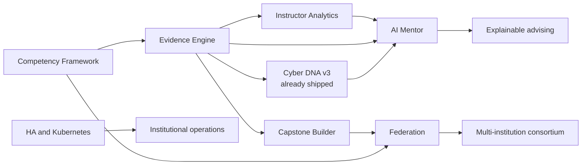

# Release 6 scope: competency, evidence, scale, and federation

Status: **planning**. No Release 6 code is implemented. This page is the scope
contract for the release; the signed tag and [`versions.yaml`](../versions.yaml)
remain the source of truth for the current release.

Release 5 proved the teaching loop: 214 labs, a competency contract for every
lab, deterministic flag scoring, Cyber DNA v3, and a single-host deployment that
two campuses can run. Release 6 makes that loop **institution-grade**. It turns
the competency model into the authoritative vocabulary, makes evidence a
first-class object instead of a by-product of completion, generates capstones
from competencies, gives instructors cohort-level decisions, and adds the
deployment and federation shapes a university needs.

The order is deliberate. Competency definitions come before evidence, evidence
comes before analytics and AI, and federation comes only after the definitions
and bundles are versioned and signed.

## Design rules

- **Competency before AI.** Every object maps to a competency before any model
  is allowed to reason about it. Without that, Cyber DNA becomes subjective.
- **Evidence before completion.** A completion is an activity signal. Evidence
  is a demonstrated capability with a rubric, an artifact, and a provenance
  record.
- **Deterministic where possible.** Flags, validation steps, and rubric totals
  are deterministic. AI explains and recommends; it does not grade.
- **Human in the loop.** Instructors review evidence, approve capstone results,
  and remain the final authority for grades.
- **Local-first, privacy-first.** Federation exchanges definitions and content,
  never learner records. Analytics are aggregate. AI runs against local data or
  an approved gateway with no PII.
- **Constructive alignment.** Objectives, labs, assessments, and deliverables
  are generated from the same competency set and validated against each other.
- **Inclusive by default.** WCAG 2.2 AA, under-18 exclusions, and no public
  ranking of individual learners.
- **No forced migration.** The single-host Compose profile remains supported.
  HA and Kubernetes are an additional deployment profile, not a replacement.

## Language and localization

Release 5.36 ships **English-only UI chrome** with the backlog made visible and
gated: a bare-string baseline in CI and stable `X-Error-Code` headers on
migrated endpoints. It does not claim the UI is translated.

Release 6 adds the localization wave:

- **UI chrome:** extract Vue strings to namespaced locale catalogues, add
  French, and resolve locale from stored preference -> `Accept-Language` -> `en`.
- **Formatting:** use `Intl` date, number, and relative-time formatting with the
  resolved locale.
- **Email and PDF:** resolve the recipient's locale and translate the small
  server-side catalogue. Keep `detail` human-readable; add `X-Error-Code` for
  the client.
- **Course content:** build one MkDocs locale at a time (`mkdocs-fr-*.yml`) into
  separate wiki paths. Curriculum prose stays in the authored workbook, never in
  UI locale JSON. `curriculum-glossary.yaml` is the terminology seed.
- **RTL groundwork:** prefer CSS logical properties over `left`/`right` before a
  right-to-left locale is requested.

See [Language and localization](LANGUAGE-AND-LOCALIZATION.md) and
[API error codes](API-ERROR-CODES.md).

## What already exists

Release 6 builds on shipped pieces; it is not a blank page.

| Foundation | Current state |
|---|---|
| Competency taxonomy | 212 competencies in domains and categories (`app/data/competency-taxonomy.yaml`) |
| Lab contracts | 214 labs mapped; 25 reviewed, 189 baseline derived, awaiting subject-matter review |
| Scoring model | Five dimensions: knowledge 20%, execution 30%, troubleshooting 20%, documentation 15%, communication 15% |
| Pathways | 13 curriculum roles, including SOC Analyst, Incident Responder, and Detection Engineer |
| Evidence | Flag attempts, lab completions, quiz attempts, workbook answers, learner snapshots, review requests |
| Cyber DNA | Evidence ledger, eight-axis radar, six traits, gated affinity, immutable snapshots |
| Analytics | Last-7-day activity, course health, exercise diagnostics, programme reports, signed exports |
| Credentials | Open Badges 3.0 scope and level certificates |
| Operations | Scheduler leader election, signed supply chain, backup and restore drills |

The gap is not invention. It is **completeness, versioning, and a shared evidence
model** across those pieces.

## Pillars

| # | Pillar | Outcome | Depends on | Train |
|---|---|---|---|---|
| 1 | [Competency Framework](COMPETENCY-FRAMEWORK.md) | Authoritative, versioned competency model and object mappings | - | 6.0 |
| 2 | [Evidence Engine](EVIDENCE-ENGINE.md) | Evidence records, rubrics, automated collection, instructor review | Pillar 1 | 6.0 |
| 3 | [Capstone Builder](CAPSTONE-BUILDER.md) | Competency-driven capstone generation and validation (requested Priority 5 automation) | Pillars 1, 2 | 6.1 |
| 4 | [Instructor Analytics](INSTRUCTOR-ANALYTICS.md) | Cohort competency, weakest domains, failed labs, velocity, utilization, drop-off | Pillars 1, 2 | 6.1 |
| 5 | [HA and Kubernetes](HA-AND-KUBERNETES.md) | Highly available control plane and a scale-out lab node pool | Pillar 2 (evidence continuity) | 6.2 |
| 6 | [Federation](FEDERATION.md) | Signed exchange of competencies, content, rubrics, and capstones; no learner data | Pillars 1, 2, 3 | 6.3 |
| 7 | [AI Mentor](AI-MENTOR.md) | Grounded study, career, and evidence explanations with citations | Pillars 1, 2, 4 | 6.4 |

## Dependency graph

## Release train

| Release | Theme | Ships | Exit criteria |
|---|---|---|---|
| 6.0 | Foundation | Complete competency coverage, evidence model, rubrics, automated collection for flags/workbook/artifacts, instructor review workflow, analytics v1 | Every lab, quiz, assessment, capstone, and badge maps to a competency; evidence can be created, reviewed, and replayed; no learner-visible score without coverage |
| 6.1 | Capstone and cohort decisions | Capstone Builder MVP, Blue Team Analyst template, capstone evidence, the six instructor dashboards | An instructor generates, edits, validates, and publishes a capstone; every dashboard answers its question from live data with small-cohort suppression |
| 6.2 | Scale and availability | Kubernetes reference profile, HA PostgreSQL, Valkey, object storage, lab node pool, backup and disaster-recovery drills, and the `health.swocts.com` monitoring stack | Control plane survives a node loss; a lab host can drain without losing evidence; RPO and RTO met in a drill; the monitoring stack survives a monitored host loss and pages externally |
| 6.3 | Federation | Signed competency, content, rubric, and capstone bundles; import preview and diff; trust registry | Two institutions exchange a competency bundle and a capstone template; no learner row crosses the boundary |
| 6.4 | AI Mentor and academic validation | Grounded mentor, citations, evaluation harness, pilot study | Every recommendation cites evidence; no PII leaves the trust boundary; evaluation report published |
| 6.5 | Language and localization | French UI chrome, localized email/PDF, per-locale MkDocs builds, RTL groundwork | No bare-string growth; every extracted key has a French value; a French recipient receives a French email and PDF; a `dir="rtl"` smoke page does not break layout |

## Academic value

Release 6 is designed for the questions an academic review actually asks.

- **Constructive alignment.** Objectives, learning activities, and assessments
  are generated from the same competency set and validated for coverage.
- **Authentic assessment.** Capstones produce timelines, findings, remediation
  plans, and executive briefs, not only a flag.
- **Accreditation evidence.** Competency mappings support NICE/NIST work roles,
  ACM/IEEE CS2023 knowledge areas, CAE-CD outcomes, and programme-level
  accreditation evidence.
- **Competency-based transcripts.** Evidence produces defensible competency
  statements and Open Badges 3.0 credentials.
- **Privacy and sovereignty.** Institutions keep learner data; federation is a
  signed exchange of definitions and content.
- **Equity and inclusion.** Aggregate analytics, no learner ranking, automatic
  under-18 exclusions, and accessible evidence capture.
- **Evaluability.** Rubric reliability, coverage, time-to-readiness, and
  intervention outcomes can be measured, not asserted.

## Success measures

| Measure | Target |
|---|---|
| Labs with a reviewed competency contract | 214 of 214 |
| Objects with a competency mapping | 100% of labs, quizzes, assessments, capstones, badges |
| Evidence records with a rubric version and provenance | 100% |
| Capstone generation coverage of a role profile | At least 90% of critical competencies |
| Instructor dashboard load with 200 learners | Under 2 seconds at p95 |
| Small-cohort suppression | No aggregate below 5 learners |
| HA control-plane availability in a drill | 99.9% target; no evidence loss on node loss |
| Federation learner-data leakage | Zero rows; verified by a boundary test |
| AI citations to real evidence | 100% of recommendations; no uncited claim |
| Untranslated UI strings | No file grows beyond its baseline; the total does not increase between releases |

## Non-goals

- No employer, recruiter, or public learner profile. Cyber DNA affinity remains
  owner-only.
- No ranking of individual learners in analytics or capstones.
- No learner data in a federation bundle, a central warehouse, or an AI prompt.
- No LLM grading, no model-only pass/fail decision, and no replacement of
  institutional final grades.
- No claim that a competency score predicts employment.
- No rewrite of the single-host deployment; it remains the reference path.

## Risks

| Risk | Mitigation |
|---|---|
| Competency review becomes a bottleneck | Prioritize the highest-use baseline-derived contracts; publish a review queue and calibration guide |
| Evidence capture adds instructor work | Automate deterministic evidence; reserve review for rubric and artifact cases |
| Analytics become surveillance | Aggregate-only, small-cohort suppression, under-18 exclusion, no individual ranking |
| Capstone generation produces a plausible but misaligned plan | Validation gate: coverage, prerequisites, workload, evidence, assessment weights |
| Federation leaks data through metadata | Bundle schema excludes learner rows; boundary test; signed manifests |
| AI hallucinates a competency change | Tool-grounded responses, citations, confidence, deterministic fallback |
| Kubernetes makes lab networking fragile | Dedicated lab node pool with a node agent and explicit network policy; keep Compose for small sites |

## Governance

- **Competency council.** Owns taxonomy, hierarchy, scoring weights, and versioned
  changes.
- **Evidence board.** Owns rubric standards, calibration, and review appeals.
- **Federation registry.** Owns signing keys, trust lists, and bundle
  compatibility.
- **AI review board.** Owns evaluation, privacy review, and human-oversight
  policy.
- **Release gate.** No pillar ships without its acceptance criteria, tests, and
  a documented rollback.

## Documents

- [Competency Framework](COMPETENCY-FRAMEWORK.md) and [contract review queue](COMPETENCY-REVIEW-QUEUE.md)
- [Evidence Engine](EVIDENCE-ENGINE.md)
- [Capstone Builder](CAPSTONE-BUILDER.md)
- [Instructor Analytics](INSTRUCTOR-ANALYTICS.md)
- [HA and Kubernetes](HA-AND-KUBERNETES.md)
- [Federation](FEDERATION.md)
- [AI Mentor](AI-MENTOR.md)
- [Language and localization](LANGUAGE-AND-LOCALIZATION.md)
- [API error codes](API-ERROR-CODES.md)
- [ADR 0005: Release 6 is evidence-first](decisions/0005-release-6-evidence-first.md)
