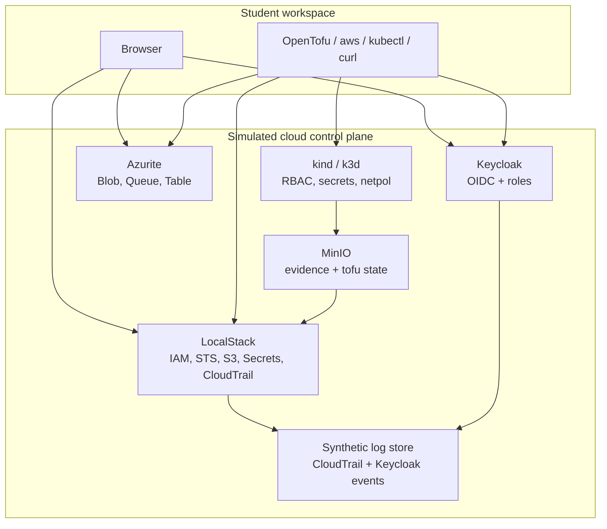

# Simulated cloud range

Status: **reference design and local scaffold** (18 November 2026). The stack
is not wired into the production Compose profile and is not a replacement for a
real cloud account.

Presentation follows [progressive disclosure](INFORMATION-DESIGN-PROGRESSIVE-DISCLOSURE.md): summary first, detail on request, and the learner controls what stays visible.

Goal: let learners practise **IAM policy, storage security, secrets management,
and cloud incident response** with the same operational shape as a cloud
tenant, at zero cloud cost and with no real credentials.

## 1. Design rule: simulate the control plane, not the bill

The range provides a local control plane, identity provider, object store, and
Kubernetes workload plane. Every credential is synthetic. Every resource is
disposable. Nothing reaches a public cloud API.

This is a teaching simulator. It is not a compliance boundary and must never
hold real learner, institutional, or production data.

## 2. Component roles

| Component | Role in the range | Limit |
|---|---|---|
| **LocalStack** | AWS-like IAM, STS, S3, Secrets Manager, CloudTrail, Lambda, and logs | Community edition; single account, name-prefixed tenants |
| **Azurite** | Azure Storage-compatible Blob, Queue, and Table endpoints | Storage only; no Azure Resource Manager |
| **MinIO** | S3-compatible evidence and OpenTofu state store | Local object store, not a production backup target |
| **Keycloak** | OIDC/OAuth identity provider that stands in for Entra ID or an enterprise IdP | Realm-per-cohort; no real Entra Conditional Access engine |
| **OpenTofu** | Infrastructure-as-code practice, plan/apply, drift, policy checks | AWS provider targets LocalStack; Azure provider needs a mock ARM path |
| **Kubernetes** | Workload plane for RBAC, secrets, network policy, and admission labs | `kind` or `k3d` on the host; not a privileged container in the app stack |

### Important accuracy note

LocalStack simulates **AWS**, not Azure. Azurite simulates **Azure Storage**,
not Azure Resource Manager. Keycloak is an OIDC provider, not Microsoft Entra
ID. A fully Azure-like experience therefore needs one of these choices:

1. **AWS-like profile (ready now):** LocalStack carries the IAM, storage,
   secrets, and logging scenarios. Teach the primitives, then map them to Azure
   vocabulary in the workbook.
2. **Azure-like profile (phase 2):** Azurite for storage, Keycloak for OIDC and
   role claims, and a small **mock ARM adapter** for subscriptions, resource
   groups, role assignments, and activity-log events. Do not claim full Azure
   parity before that adapter exists.

The scaffold in `platform/simulated-cloud/` implements the AWS-like profile and
the Azure Storage endpoint. It deliberately does not fake ARM.

### Azure-to-local service map

| Azure service | Local alternative | What the learner still practises |
|---|---|---|
| Microsoft Entra ID | Keycloak (+ OpenLDAP/FreeIPA federation) | OIDC, groups, role claims, MFA, consent, session revocation |
| Blob Storage | MinIO (Azurite for Azure Storage API shape) | Container ACLs, public access, versioning, retention |
| Azure SQL | PostgreSQL | Database roles, row-level security, connection secrets |
| Azure Monitor | OpenSearch + OpenSearch Dashboards | Log search, alert queries, dashboards |
| Microsoft Sentinel | Wazuh + OpenSearch + Sigma | Detection engineering, ATT&CK mapping, triage |
| Key Vault | HashiCorp Vault | Secret storage, rotation, access policy |
| AKS | k3s or kind | RBAC, secrets, NetworkPolicy, admission |
| App Services | Docker Compose | Workload deployment and configuration |
| Logic Apps | n8n | Automated response and ticket enrichment |
| VNet / subnet / NSG | Docker networks, FRR/VyOS, nftables, k3s NetworkPolicy | Segmentation, routing, default deny, private endpoints |

The workbook must state the mapping every time an Azure term is used, so a
learner does not mistake Keycloak for Entra ID or LocalStack for Azure.


## 3. Architecture



### Tenancy

Use one shared control plane per cohort and isolate learners by prefix:

- LocalStack: IAM user/role names and S3 bucket names start with `s<student-id>-`.
- Keycloak: one group per learner, plus realm roles `cloud-admin`,
  `cloud-analyst`, `cloud-auditor`, and `student`.
- MinIO: one prefix per learner, for example `students/s42/`.
- Azurite: one container prefix per learner.
- Kubernetes: one namespace per learner, with a `ResourceQuota`,
  `LimitRange`, and `NetworkPolicy`.

A per-learner control plane is too expensive. Prefix isolation plus a reset job
is the supported shape for a class.

### Reset

A reset job deletes learner-prefixed IAM resources, S3 buckets, secrets,
Azurite containers, Kubernetes namespaces, and MinIO prefixes. It must never
delete the shared realm, the shared OpenTofu state bucket, or the evidence
bucket. Reset is idempotent and logged.

## 4. Lab catalogue

The first release should be ten labs. Each lab produces a flag and one evidence
artifact, so the learner leaves with a portfolio item rather than a score.

### IAM policies

1. **Over-permissioned analyst** — an IAM user can read every bucket and assume
   an admin role. The learner enumerates effective permissions, writes a
   least-privilege policy, and proves the allowed and denied actions.
2. **Role trust policy** — a service role trusts any principal. The learner
   narrows the trust policy and demonstrates the confused-deputy path is closed.
3. **Break-glass review** — a temporary admin role is left active. The learner
   finds it, sets a time-bound approval path, and records the review evidence.

### Storage security

4. **Public bucket** — an S3 bucket policy allows `Principal: "*"`. The learner
   detects the exposure, removes it, enables block-public-access and
   versioning, and writes the finding.
5. **Azure blob exposure** — an Azurite container is public. The learner fixes
   the container ACL and explains the difference between blob and container
   access levels.
6. **Lifecycle and retention** — evidence objects are overwritten. The learner
   adds versioning, object lock where supported, and a lifecycle rule, then
   proves an old version can be restored.

### Secrets management

7. **Secret in the pipeline** — a deployment manifest contains a plaintext
   secret. The learner moves it to Secrets Manager, rotates it, and updates the
   workload without committing the new value.
8. **Kubernetes secret handling** — a service account can read every secret in
   the namespace. The learner applies RBAC and a `Secret`-free workload pattern,
   then verifies the denied access.

### Incident response

9. **Compromised access key** — CloudTrail-style events show a key used from a
   new location to list and copy objects. The learner builds a timeline,
   contains the key, preserves evidence, and writes the executive summary.
10. **Cloud capstone** — a multi-stage intrusion across identity, storage, and
    Kubernetes. The learner produces a timeline, containment record, root-cause
    finding, and remediation plan.

### Stretch labs

- OpenTofu drift: apply a known-good stack, introduce console drift, detect it
  with `tofu plan`, and reconcile it.
- Detection engineering: write a Sigma or KQL-style rule for the compromised-key
  pattern and test it against synthetic events.
- Policy as code: add a `tofu` plan check that rejects public buckets and
  wildcard IAM policies.
- GRC evidence: map the storage and IAM controls to NIST CSF 2.0 and collect
  the screenshots, policy JSON, and logs as audit evidence.

## 4.1 Sentinel-like detection engineering

Stack: **Sysmon-style synthetic events, Wazuh, OpenSearch, OpenSearch
Dashboards, Sigma rules, and ATT&CK Navigator**.

Learner tasks:

1. Search sign-in, audit, and object-access events for a suspicious pattern.
2. Write a detection as a Sigma rule, convert it to the local query language,
   and test it against the sample event set.
3. Map the detection to a MITRE ATT&CK technique and record the false-positive
   reasoning.
4. Tune the rule until the true positive fires and the benign baseline does not.
5. Add the rule to the detection-as-code directory and open a review note.

Acceptance evidence: the query, the Sigma rule, the ATT&CK mapping, the test
result, and a short explanation of the trade-off between sensitivity and noise.

## 4.2 Entra-like identity labs

Stack: **Keycloak, OpenLDAP, and an optional FreeIPA instance**.

Scenarios:

- **OAuth consent attack** — a malicious application receives delegated Graph
  permissions. The learner reviews sign-in and consent events, identifies the
  application and scopes, revokes consent, and records the persistence path.
- **Excessive privilege** — a group grants tenant-wide administration. The
  learner reviews role assignments, removes the dangerous permission, and
  proves the reduced access.
- **MFA simulation** — the learner enrols a second factor, tests a risky
  sign-in policy, and documents the challenge and fallback path.
- **Session revocation** — after a simulated compromise, the learner revokes
  sessions and refresh tokens and verifies the old token no longer works.
- **Conditional Access** — the learner creates a policy in Keycloak
  authentication flows and tests enforcement for a risky sign-in.

Keycloak is not Entra ID Conditional Access. The workbook must say so and explain
which behaviour is being simulated (claims, groups, OIDC scopes, session
revocation) and which is out of scope.

## 4.3 Defender for Cloud-like posture scanning

Stack: **OpenSCAP, Trivy, Prowler, ScoutSuite, and the local `scanner` service**.

The scanner reports findings such as:

- public storage bucket;
- wildcard IAM policy;
- stale access key;
- plaintext secret in a manifest;
- privileged container or hostPath mount;
- missing encryption or versioning.

Learner tasks:

1. Triage the finding list and rank by exposure and business impact.
2. Reproduce the finding with a command or policy document.
3. Fix the configuration and rescan.
4. Record the evidence and the residual risk.
5. Map the finding to a NIST CSF 2.0 control and an Azure concept.

## 4.4 Incident-response lab: OAuth consent to Graph access

**Scenario.** A learner opens a phishing email and approves a look-alike
application. The attacker obtains delegated Graph-like access. The learner must
review audit logs, identify persistence, revoke sessions, and produce a report.

**Local mapping.**

| Azure concept | Local service |
|---|---|
| Entra ID sign-in and audit logs | Keycloak events, OpenSearch index |
| OAuth application consent | Keycloak client and consent records |
| Graph API access | Synthetic API events and object-store access logs |
| Session revocation | Keycloak logout and token revocation |
| Sentinel investigation | OpenSearch Dashboards + Wazuh alerts |
| Key Vault | Vault audit log |

**Tasks.**

1. Review sign-in, consent, and audit events.
2. Identify the malicious application, scopes, and persistence mechanism.
3. Determine what data the token could reach.
4. Revoke the consent, sessions, and refresh tokens.
5. Preserve the timeline and evidence.
6. Write a technical finding and a one-page executive summary.

**Evidence.** Event timeline, application and scope list, revocation record,
before/after token test, and report.


## 4.5 Azure-like networking labs

**Concepts:** VNet, subnet, NSG, route table, segmentation, private endpoint,
and zero trust.

**Tooling:** Docker bridge networks, FRR or VyOS containers, nftables, and k3s
NetworkPolicy. OPNsense and pfSense are FreeBSD appliances and are better run
as VMs on a KVM-capable host; do not pretend a container is the same product.
For a single-host classroom, FRR or VyOS containers cover the routing and
segmentation objectives.

Suggested labs:

1. **Subnet isolation** — place two workloads on separate Docker networks and
   prove the default path is blocked. Add an explicit route or proxy and
   document why the new path is allowed.
2. **NSG rule review** — start with an overly broad allow rule. The learner
   narrows the source, destination, and port, then proves allowed and denied
   traffic.
3. **Route leak** — advertise a route between two segments, detect the
   unexpected path, and withdraw it. Pair with the network tap.
4. **Private endpoint** — expose an object store only on an internal network
   and remove the published host port. The learner proves the public path is
   gone and the private path still works.
5. **Zero-trust workload** — apply default-deny NetworkPolicy, allow only DNS
   and one service-to-service path, and test the denied paths.

Evidence: `ip route`, `nft list ruleset`, `kubectl describe networkpolicy`,
a before/after connectivity test, and a short architecture note.

## 5. Mapping to employer gaps

| Employer gap | Labs | Evidence artifact |
|---|---|---|
| Cloud security operations | 1–10 | Policy diff, fixed bucket, incident timeline |
| Detection engineering | 9, stretch | Query, rule, MITRE mapping, false-positive note |
| Threat hunting | 9, stretch | Hunt hypothesis and event timeline |
| Incident response | 9–10 | Containment record and executive summary |
| Identity and access management | 1–3, 8 | Least-privilege policy and role-trust review |
| Security automation | 7, stretch | Script or pipeline that rotates and verifies a secret |
| Vulnerability management | stretch | Prioritised finding with exposure and business impact |
| Security architecture | 2, 4, 6 | Trust-boundary and data-flow review |
| GRC and compliance | stretch | Control-to-evidence table |
| Communication | 9–10 | Executive summary and technical report |

## 6. Reference stack

`platform/simulated-cloud/` contains:

- `docker-compose.yml` — LocalStack, Azurite, MinIO, Keycloak, and the Keycloak
  database.
- `keycloak/realm.json` — the `ocr-cloud` realm, roles, and a local-only demo
  user.
- `opentofu/aws-local/` — provider and backend examples that target LocalStack
  and MinIO.
- `k8s/` — RBAC, secret, quota, and network-policy manifests for `kind` or
  `k3d`.

Start it from that directory:

```bash
cp .env.example .env
# Change every password in .env before use.
docker compose up -d
```

Endpoints are bound to `127.0.0.1`:

| Service | URL |
|---|---|
| LocalStack | http://localhost:4566 |
| MinIO S3 | http://localhost:9000 |
| MinIO console | http://localhost:9001 |
| Azurite Blob | http://localhost:10000 |
| Keycloak | http://localhost:8080 |

Kubernetes is intentionally host-side: use `kind` or `k3d`, not a privileged
container inside the application stack.

## 7. Security requirements

- No real cloud account, API key, or payment method ever enters the range.
- No outbound internet from the cloud services. Pull images during provisioning,
  then run with egress denied.
- Every published port binds to `127.0.0.1` in development. A classroom
  deployment puts the range behind the platform's authenticated reverse proxy.
- Use synthetic users, buckets, and logs only. No learner PII.
- Rotate the demo Keycloak password and every `.env` secret before a class.
- Pin every image by digest in a release. The scaffold uses readable tags so it
  is easy to inspect; the release gate must replace them.
- Run `tofu` with a state backend in MinIO, not local state on a shared host.
- Do not give learners the MinIO root account or the Keycloak admin account.
- Keep the cloud range on its own network, separate from the lab network and
  RangeBox egress.
- Reset learner prefixes after every cohort and verify that no evidence from a
  previous learner survives.

## 8. Resource budget

A single-host reference for 30 learners:

| Service | Memory | CPU | Notes |
|---|---:|---:|---|
| LocalStack | 1.5–2 GB | 1.0 | Shared |
| Azurite | 256 MB | 0.25 | Shared |
| MinIO | 512 MB | 0.5 | Shared |
| Keycloak + Postgres | 1 GB | 0.5 | Shared |
| OpenTofu / CLI | burst | burst | Per learner |
| kind / k3d | 4 GB | 2.0 | Host cluster, not per learner |

The Kubernetes cluster dominates the budget. If the host cannot give it 4 GB,
run the IAM, storage, and secrets labs without Kubernetes and schedule the
Kubernetes labs on a separate host.

## 9. Assessment and achievements

Each lab records:

- the flag;
- a policy diff or fixed configuration;
- one log query or detection rule where relevant;
- a short analyst finding;
- the command history needed to reproduce the result, with secrets redacted.

Suggested collection badges:

- **Cloud Identity Defender** — all IAM labs.
- **Storage Guardian** — all storage labs.
- **Secrets Custodian** — both secrets labs.
- **Cloud Incident Responder** — the compromised-key lab and capstone.
- **Simulated Cloud Architect** — the full ten-lab sequence.

These badges belong in the normal achievement catalogue and should use the same
metadata, tiers, and points as the existing track and collection badges.

## 10. Implementation phases

1. **Phase 0 — reference stack (this change).** Compose scaffold, realm,
   OpenTofu example, Kubernetes manifests, and this design note.
2. **Phase 1 — AWS-like labs.** Implement labs 1, 4, 7, and 9 against
   LocalStack, MinIO, and Keycloak. Validate reset and evidence collection.
3. **Phase 2 — Kubernetes and Azure Storage.** Add labs 5, 6, 8, and the
   OpenTofu drift lab. Add `kind`/`k3d` provisioning.
4. **Phase 3 — capstone and assessment.** Add lab 10, the evidence schema, and
   the collection badges.
5. **Phase 4 — classroom operations.** Per-learner prefixes, reset job, quotas,
   monitoring, and a load test with 30 simulated learners.

## 11. Acceptance criteria

- A learner can complete the IAM, storage, secrets, and incident-response labs
  with no outbound internet and no paid cloud account.
- A reset returns the range to a clean state in under five minutes.
- Every lab produces a flag and an evidence artifact.
- The range runs on the documented single-host budget, or clearly reports that
  Kubernetes must move to a second host.
- No real credential or learner PII is stored in the range.
- The platform can show completion, evidence, and the collection badge.

## 12. Open decisions

- Is the first release AWS-like (LocalStack) or Azure-like (Azurite plus a mock
  ARM adapter)? The scaffold supports AWS-like control-plane labs today.
- Which SIEM surface hosts the synthetic CloudTrail and Keycloak events?
- Does the institution want a shared cohort range or a per-class range?
- What is the retention period for cloud evidence artifacts?
- Who owns the Kubernetes host and its upgrade path?
