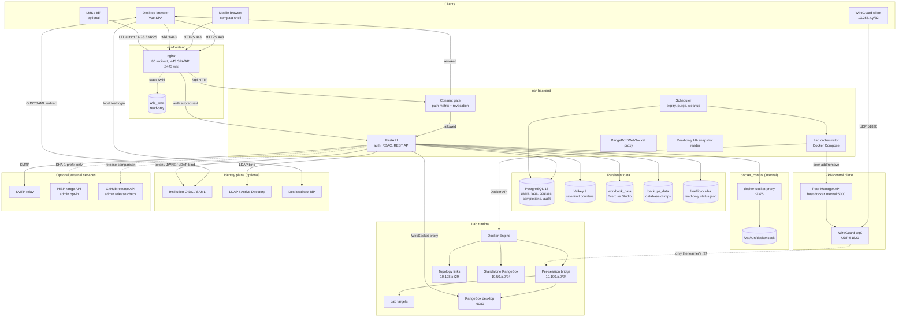
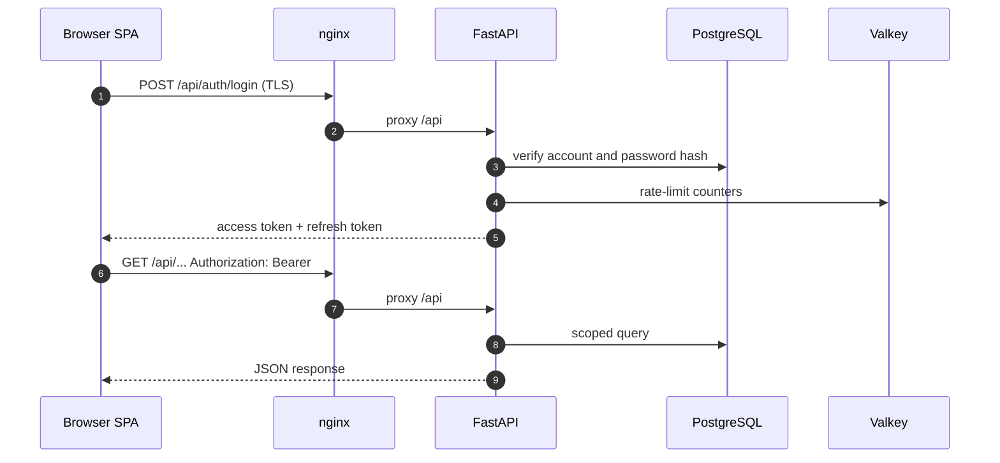
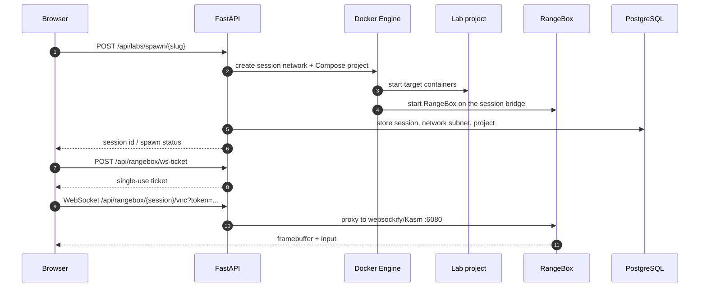
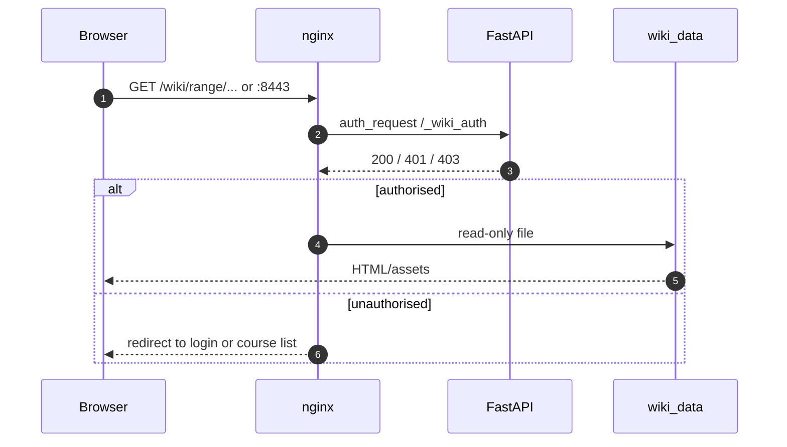
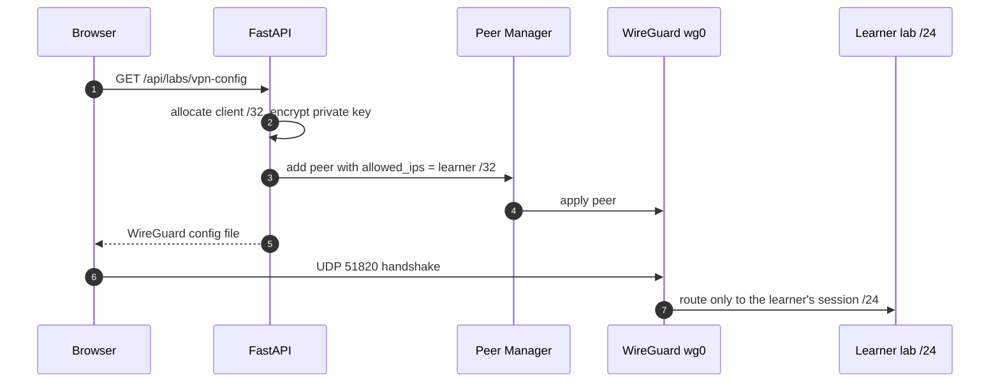
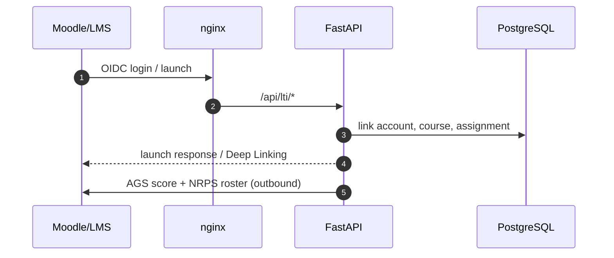

# Infrastructure and component communications

Status: **current for release 5.56.1** (26 November 2026).

This page shows the runtime components and every communication path that matters
for operation, security review, and troubleshooting. It uses placeholders for
real addresses. The detailed internal addressing is in
[NETWORK-MAP.md](NETWORK-MAP.md).

## Runtime topology

## Communication matrix

| Source | Destination | Transport / port | Authentication and exposure | Purpose |
|---|---|---|---|---|
| Browser | `ocr-frontend` nginx | HTTPS `443/TCP`; WebSocket upgrade on `/api/rangebox/*` | Public edge; SPA login, Bearer token on API, short-lived VNC ticket | SPA, API, RangeBox desktop |
| Browser | `ocr-frontend` nginx | HTTPS `8443/TCP` | `wiki_session` HttpOnly cookie, validated by nginx `auth_request` | Workbook/wiki origin |
| Browser | `ocr-frontend` nginx | HTTP `80/TCP` | Redirect to HTTPS | Edge redirect |
| nginx | `ocr-backend` | HTTP `8000/TCP` on the Compose network; host binding `127.0.0.1:8000` | Internal only; CORS allowlist; trusted proxy headers | REST API, auth subrequests |
| nginx | `_wiki_auth` -> backend `/api/auth/me` | Internal subrequest | `wiki_session` cookie forwarded as Bearer | Validate wiki session |
| nginx | `_wiki_course_auth` -> backend `/api/auth/wiki-access` | Internal subrequest | Cookie plus course entitlement check | Course-only chapter gate |
| nginx | `_wiki_admin_auth` -> backend `/api/auth/wiki-admin-access` | Internal subrequest | Cookie plus admin role check | Admin wiki gate |
| nginx | `wiki_data` volume | Read-only filesystem | Mounted `:ro` | Serve generated MkDocs HTML |
| Backend | PostgreSQL `ocr-db` | PostgreSQL `5432/TCP` | App database role; parameterised SQL; TLS depends on deployment | Durable state |
| Backend | Valkey `ocr-valkey` | RESP `6379/TCP` | Private Compose network | Shared rate-limit counters |
| Backend | `ocr-docker-proxy` | HTTP `2375/TCP` on `docker_control` | Internal-only network; proxy is unauthenticated by design and reachable only by backend | Container/network/volume operations |
| Docker proxy | `/var/run/docker.sock` | Unix socket, read-only mount | Host control plane | Execute allowlisted Docker API calls |
| Backend | RangeBox websockify/Kasm | `ws://rangebox:6080` on session network | Backend validates a single-use WebSocket ticket; never exposed directly | noVNC/Kasm VNC stream |
| Backend | Peer Manager API | HTTP `host.docker.internal:5000` | `WG_API_KEY` | Add, remove, reconcile WireGuard peers |
| WireGuard client | Host `wg0` | UDP `51820` | Per-user peer key and `/32` client address | Reach only the learner's lab `/24` |
| Backend/scheduler | Lab containers | Docker API; tester traffic on session bridge | Orchestrator creates per-session project; no host networking | Spawn, health, teardown, tests |
| Backend | SMTP relay | SMTP `587/TCP` or configured port | Deployment credentials | Password reset and notifications |
| Backend | HIBP range API | HTTPS `443` | Admin opt-in; only first five SHA-1 characters leave the server | Password-breach range check |
| Backend | GitHub releases API | HTTPS `443` | Public read; admin release-status panel | Compare installed release with latest |
| LMS | nginx/backend | HTTPS `/api/lti/*` | LTI 1.3 signed launch, AGS/NRPS OAuth | Course launch, grade passback, roster |
| Backend | LMS (AGS/NRPS) | HTTPS `443` outbound | OAuth client credentials / LTI registration | Post scores and read the roster |
| Browser | Institution IdP | HTTPS redirect | OIDC/SAML | SSO login |
| Backend | IdP / LDAP / Dex | HTTPS / LDAPS / LDAP | Provider secrets encrypted at rest | Token exchange, JWKS, directory bind |
| Host collector | `/var/lib/ocr-ha/status.json` | Local file, read-only mount | Host-owned; no network API | Read-only HA card data |

## Request flows

### Login and ordinary API request

### Start a lab and open RangeBox

### Workbook/wiki request

### VPN configuration and lab access

### LTI launch and grade passback

## Trust boundaries and least privilege

- **Public edge:** only nginx publishes `80`, `443`, and `8443`. The backend is
  bound to `127.0.0.1:8000`, and PostgreSQL/Valkey are not published.
- **Docker control:** `docker_control` is an internal Compose network. Only the
  backend and the socket proxy join it; the frontend, database, cache, and lab
  containers do not.
- **Lab isolation:** each session gets its own bridge and `/24`; no cross-session
  routing. Lab containers have no host networking, no Docker socket, and no
  privileged mode.
- **VPN:** a learner gets a `/32` client address and a route only to their own
  session `/24`. Firewall rules drop lab/RangeBox subnets from external
  interfaces.
- **Wiki:** the wiki volume is read-only in the frontend; nginx calls backend
  auth subrequests before serving any protected page.
- **Consent:** the consent gate runs before the API for covered paths and
  returns `403` when revoked.
- **HA:** the backend reads a host-written snapshot; it never promotes, fails
  over, or writes the witness state.

## Related

- [NETWORK-MAP.md](NETWORK-MAP.md) for addresses, Docker networks, and ports.
- [SOFTWARE-METADATA.md](SOFTWARE-METADATA.md) for versions and latest releases.
- [API-CAPABILITIES.md](API-CAPABILITIES.md) and [openapi.json](openapi.json) for the API contract.
