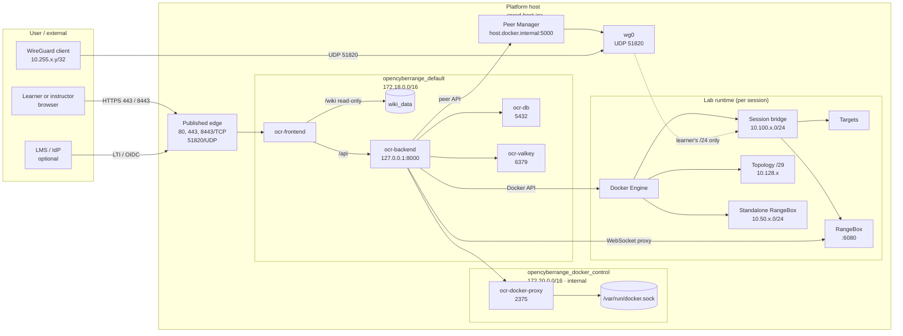

# Internal network map

Status: **current for release 5.56.1** (26 November 2026).

This map describes the production Compose stack and the lab/VPN networks it
creates. Real public addresses and the management IP are replaced with
placeholders. Docker chooses bridge subnets at creation time; the ranges below
are the ranges observed on the current production host and may differ on a
fresh install.

## Network zones

## Docker networks

| Network | Observed subnet / gateway | Membership | Exposure | Purpose |
|---|---|---|---|---|
| `opencyberrange_default` | `172.18.0.0/16`, gateway `172.18.0.1` | `ocr-frontend`, `ocr-backend`, `ocr-db`, `ocr-valkey` | Bridge; no direct host publish except the frontend ports | SPA-to-API, API-to-database/cache |
| `opencyberrange_docker_control` | `172.20.0.0/16`, gateway `172.20.0.1`; `internal: true` | `ocr-backend`, `ocr-docker-proxy` | No external route; no student-reachable service | Backend to Docker socket proxy |
| Session lab bridge | `10.100.x.0/24` per session | Session targets, exercise RangeBox | Isolated; reached by VPN or RangeBox | Learner lab traffic |
| Topology link | `10.128.x.0/29` per link | Router/host/service topology nodes | Isolated inside the lab | Routed topology exercises |
| Standalone RangeBox bridge | `10.50.x.0/24` | Standalone RangeBox only | Isolated from session labs | RangeBox tab without a lab |
| WireGuard client pool | `10.255.x.y/32` per client | Learner device | VPN interface | Reach only the learner's `/24` |
| VPN lab route | `10.100.0.0/16` | `wg0` route/firewall | Allowed only through the peer route | Connect learners to session labs |

The Docker bridge subnets are not a security control by themselves. The
`docker_control` network and the session bridges are isolated by Docker,
Compose, and the host firewall rules described in
[`../ARCHITECTURE.md`](../ARCHITECTURE.md).

## Published host ports

| Port / protocol | Listener | Exposure | Purpose |
|---|---|---|---|
| `80/TCP` | `ocr-frontend` | Public | Redirect to HTTPS |
| `443/TCP` | `ocr-frontend` | Public | SPA, `/api`, WebSocket upgrade |
| `8443/TCP` | `ocr-frontend` | Public | Workbook/wiki origin |
| `51820/UDP` | host `wg0` | Public | WireGuard |
| `5555/TCP` | optional `ocr-wstunnel` | Only when deliberately enabled | Optional browser terminal transport |
| `127.0.0.1:8000/TCP` | `ocr-backend` | Loopback only | Local backend API for nginx/host diagnostics |
| `5432/TCP` | `ocr-db` | Compose network only | PostgreSQL |
| `6379/TCP` | `ocr-valkey` | Compose network only | Rate-limit counters |
| `2375/TCP` | `ocr-docker-proxy` | `docker_control` only | Docker API proxy |

Do not publish `5432`, `6379`, `2375`, or the backend's `8000` to an untrusted
network. The host firewall must keep the lab and RangeBox CIDRs off external
interfaces.

## Container inventory (core Compose stack)

| Container | Image | Network(s) | Published ports | Role |
|---|---|---|---|---|
| `ocr-frontend` | `ocr-frontend:latest` (nginx base) | `opencyberrange_default` | `80`, `443`, `8443` | TLS, SPA, `/api` proxy, wiki, VNC WebSocket edge |
| `ocr-backend` | built from `platform/backend` | `opencyberrange_default`, `opencyberrange_docker_control` | `127.0.0.1:8000` | FastAPI, scheduler, orchestrator, consent gate |
| `ocr-db` | `postgres:15-alpine` | `opencyberrange_default` | none | Durable relational state |
| `ocr-valkey` | `valkey/valkey:9.1.3-alpine` | `opencyberrange_default` | none | Shared rate-limit counters |
| `ocr-docker-proxy` | `tecnativa/docker-socket-proxy:0.3.0` | `opencyberrange_docker_control` | none | Allowlisted Docker API on `2375` |
| `ocr-wiki-builder` | `ocr-wiki-builder:latest` | `tools` profile; repo + `wiki_data` volumes | none | One-shot MkDocs build |
| `ocr-ldap` | `osixia/openldap:1.5.0` | optional `sso` profile | none | LDAP test/integration IdP |
| `ocr-dex` | `ghcr.io/dexidp/dex:v2.42.0` | optional `sso` profile | none | Local OIDC test IdP |
| `ocr-ha-sync` | `alpine:3.20` | host bridge | none | Optional host HA snapshot sync (observed production add-on) |
| `ocr-redis-gateway` | `nginx:1.27-alpine` | `opencyberrange_default` | `<management-ip>:6379` (operator add-on) | Optional HA cache gateway |
| `ocr-pg-gateway` | `alpine/socat` | `opencyberrange_default` | `<management-ip>:5432` (operator add-on) | Optional HA database gateway |
| `ocr-monitoring-node-exporter` | `prom/node-exporter:v1.9.1` | monitoring bridge | `<management-ip>:9100` | Host metrics |

The last four rows are operator add-ons observed on the current production host,
not part of the base `platform/docker-compose.prod.yml` stack. A clean install
does not need them.

## Lab and VPN address plan

| Range | Allocation | Notes |
|---|---|---|
| `10.100.0.0/16` | Session lab pool | Each session receives one `/24`; the VPN route/firewall allows only the learner's `/24` |
| `10.100.x.0/24` | One session | Targets and the exercise RangeBox; separate bridge per session |
| `10.128.0.0/9` | Topology lab space | `/29` point-to-point links between topology nodes |
| `10.50.x.0/24` | Standalone RangeBox | No lab target attached |
| `10.255.0.0/16` | VPN client pool | One `/32` per peer |
| `10.0.0.1` | `wg0` server address | Configurable; HA hosts must not reuse the same address |

The backend allocates and records the session subnet; `get_rangebox_ip()` fails
closed if the proxy network or subnet is missing, rather than guessing a base
`.2`.

## DNS and name resolution

| Name | Resolver | Scope |
|---|---|---|
| `ocr-frontend`, `ocr-backend`, `ocr-db`, `ocr-valkey`, `ocr-docker-proxy` | Docker embedded DNS `127.0.0.11` | Compose networks |
| `host.docker.internal` | Compose `host-gateway` | Backend to host Peer Manager |
| `<target>.lab` names | Lab DNS / RangeBox resolver | Inside the session network |
| Public platform hostname | Institutional DNS / reverse proxy | Public edge |

## Firewall and isolation rules

- Only `443/TCP`, `8443/TCP`, and `51820/UDP` are learner-facing. `5555/TCP` is
  optional and disabled by default.
- `5432/TCP`, `6379/TCP`, `2375/TCP`, and backend `8000/TCP` stay internal or
  loopback.
- Lab and RangeBox subnets are dropped on external interfaces; the VPN peer
  routes only the assigned `/24`.
- `docker_control` is `internal: true`; the Docker socket is mounted only into
  the proxy container, not into labs.
- Every session gets its own bridge; cross-session traffic is not routed.
- The host firewall state and Docker `DOCKER-USER` rules are part of the release
  check. See [`../ARCHITECTURE.md`](../ARCHITECTURE.md) and
  [`../HOST-SCRIPT-SECURITY.md`](../HOST-SCRIPT-SECURITY.md).

## What is not in this release

- There is no split database or multi-host lab pool in Release 5.
- The optional HA collector is read-only; it does not promote or fail over.
- The Authentik, Moodle, and monitoring stacks observed on the production host
  are separate operator services; they are not required by the platform Compose
  file.

## Related

- [INFRASTRUCTURE.md](INFRASTRUCTURE.md) for component roles and request flows.
- [SOFTWARE-METADATA.md](SOFTWARE-METADATA.md) for the images and versions.
- [`../ARCHITECTURE.md`](../ARCHITECTURE.md) for the threat model and trust boundaries.
- [`../DEPLOYMENT-TOPOLOGY-AND-SIZING.md`](../DEPLOYMENT-TOPOLOGY-AND-SIZING.md) for sizing and exposure rules.
